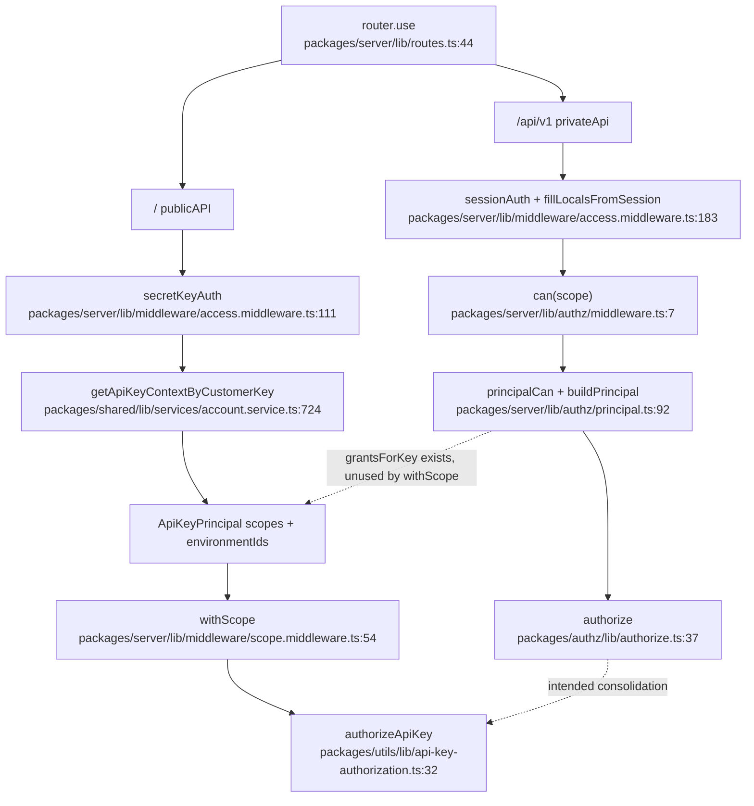

# Authorization (grants)

`.deep-understand/` can be gitignored; this file is a working document, not a commit.

## What this is and why it exists

Nango is mid-migration to a **grant** model: a principal is allowed to do X (a **scope**) *where* Y (a **where** selector). Authentication is supposed to resolve a `Principal`; authorization is supposed to ask `authorize(principal, scope, target)`. That kernel lives in `@nangohq/authz` and is already what dashboard RBAC uses.

The two HTTP surfaces have not caught up with each other.

- **Private endpoints** (`/api/v1/…`, the dashboard) authenticate a session user, look up their `role`, turn the role into grants, and enforce with `can(scope)`.
- **Public endpoints** (no prefix; Bearer API key) already speak scopes, but persist “where” as rows in `customer_keys_relations`, not as grant `where` selectors. At request time those rows become `environmentIds` on an `ApiKeyPrincipal`. Enforcement still goes through a separate function, `authorizeApiKey`, not through `authorize`. A mapper from that shape onto grants exists (`grantsForKey`) and is tested, but public middleware does not call it.

The intended end state is one principal, one `authorize`, grants stored as grants. Today the grant kernel is real, RBAC uses it, and the public API is a parallel engine with a runtime mapping waiting to be the storage format.

This document traces the **dashboard path** end to end — session → principal → `can` → `authorize` — because that is the path the grant system actually runs on. The public-key path is mapped as a sibling, not traced line by line.

## Vocabulary

- **Scope** — a concrete string a route requires, e.g. `environment:connections:read` or `account:team:update`. Namespaced `account:` or `environment:`. Defined as this repo uses them in `packages/authz/lib/scopes.ts`.
- **Scope selector** — a scope or a wildcard over one namespace (`environment:*`, `environment:connections:*`). Wildcards are prefix matches: `environment:*` matches anything starting with `environment:`.
- **Issuable / public scope** — a scope a customer credential (API key) may hold. `PUBLIC_ENVIRONMENT_SCOPES` + `PUBLIC_ACCOUNT_SCOPES`.
- **Private / non-issuable scope** — a scope only a role may hold. `environment:*` on a key does **not** expand to these. Examples: `environment:settings:read_secret`, `account:api_keys:create`, `environment:delete`.
- **Where selector** — where a grant applies: `'account' | 'env:*' | 'env:production' | 'env:non-production' | 'env:${id}'`.
- **Target** — the thing being asked about right now: the account, or one environment (id + `is_production`). Derived from the required scope’s namespace plus whatever environment the request resolved.
- **Grant** — `{ can: ScopeSelector[], where: WhereSelector[] }`. Both arrays are unions: any matching selector is enough. Multiple grants are also a union.
- **Principal** — `{ subject, accountId, grants }`. Subject is `user` | `api_key` | `connect_session`. `accountId` is a hard isolation check, not a where selector.
- **Role** — one of `administrator` | `production_support` | `development_full_access`, stored on `_nango_users.role`. A role is a hardcoded grant set in `ROLES`, not a row of permissions.
- **RBAC** — the product feature that makes those three roles mean different things. Gated by `FLAG_AUTH_ROLES_ENABLED` **and** `plans.has_rbac`. When it does not apply, every user is authorized as `administrator`.
- **`ApiKeyPrincipal`** — the public-API credential shape: `scopes: string[]` plus `environmentIds: number[]`. This is not a `Principal`. It is what the relations table currently deserializes into.
- **Relation** — a `customer_keys_relations` row: `(customer_key_id, entity_type, entity_id)` with `entity_type` in `('environment', 'account')`. In practice only `'environment'` is written. Account-level keys have **no** relation rows.

## The moving parts

| File | Role |
|---|---|
| `packages/authz/lib/authorize.ts:7` | `Grant`, `Principal`, `authorize`, `issuedGrant` |
| `packages/authz/lib/scopes.ts:6` | Issuable vs private scope catalogs; `expandIssuable` |
| `packages/authz/lib/where.ts:6` | Where selectors, targets, `whereContains` |
| `packages/authz/lib/roles.ts:7` | `ROLES` — the three role grant sets |
| `packages/types/lib/api-keys/scopes.ts:4` | Duplicate issuable-scope catalog (types package; must stay in lockstep) |
| `packages/types/lib/api-keys/auth.ts:7` | `ApiKeyPrincipal` (scopes + environmentIds) |
| `packages/types/lib/user/db.ts:3` | `Role` union |
| `packages/server/lib/authz/principal.ts:46` | `buildPrincipal` / `grantsForRole` / `grantsForKey` / `principalCan` |
| `packages/server/lib/authz/middleware.ts:7` | `can(scope)` — private-route middleware |
| `packages/server/lib/middleware/scope.middleware.ts:54` | `withScope` / `withAnyScope` — public-route middleware |
| `packages/utils/lib/api-key-authorization.ts:32` | `authorizeApiKey` — the public engine |
| `packages/server/lib/middleware/access.middleware.ts:111` | Auth: `secretKeyAuth`, `sessionAuth`, `fillLocalsFromSession` |
| `packages/shared/lib/services/account.service.ts:724` | Key lookup: relations → `environmentIds` in memory |
| `packages/shared/lib/services/customerKey.service.ts:122` | Create/list keys; product-side account vs environment split |
| `packages/database/lib/migrations/20260420120000_create_customer_keys.cjs:33` | `customer_keys` + `customer_keys_relations` |
| `packages/server/lib/routes.ts:44` | Mount: `/api/v1` → private, `/` → public |
| `packages/server/lib/routes.private.ts:279` | `can(...)` on dashboard routes |
| `packages/server/lib/routes.public.ts:128` | `apiAuth` + `withScope(...)` on public routes |
| `packages/server/lib/controllers/v1/user/getUser.ts:20` | Ships `grants` to the dashboard |
| `packages/webapp/src/hooks/usePermissions.tsx:12` | Client-side `authorizeIn` against those grants |
| `packages/server/lib/utils/rbac.ts:8` | `hasRbac` — invite/role-change product gate (not the same as `rbacApplies`) |

## The flow

Two surfaces, one kernel. Authentication fills `res.locals`; authorization is a different function on each surface.



## The code path, step by step

Main path: a signed-in dashboard user `PATCH /api/v1/environments?env=dev` to change settings. Chosen because it is a real `can('environment:settings:update')` check against a role’s grants, with an environment target. Error paths and the public-key sibling are in “Conditions” and “Worth its own dive”.

### 1. The request lands on the private router

`packages/server/lib/routes.ts:44` mounts `privateApi` at `/api/v1`. The matching route is:

```310:310:packages/server/lib/routes.private.ts
web.route('/environments/').patch(webAuth, auditEnvironmentUpdated, can('environment:settings:update'), patchEnvironment);
```

`webAuth` is session auth (passport + `sessionAuth` + rate limit) in cloud; tests swap it for `testAuth`.

### 2. Authentication fills locals, including the environment

`sessionAuth` requires `req.isAuthenticated()`, then `fillLocalsFromSession` loads the user, account, and plan onto `res.locals`. For most routes it then requires `?env=` and loads that environment.

A handful of paths skip the environment on purpose (`ignoreEnvPaths`: `/api/v1/user`, `/api/v1/meta`, `/api/v1/account/api-keys`, `/api/v1/audit-trail`, …). Those are the account-plane routes. An environment-scoped `can()` on one of them throws `ScopeRequiresEnvironmentError` rather than returning 403 — a wiring bug, not a client error.

After this step: `locals.user`, `locals.account`, `locals.plan`, usually `locals.environment`. No `Principal` yet.

### 3. `can(scope)` asks the principal

```7:16:packages/server/lib/authz/middleware.ts
export function can(scope: Scope): RequestHandler {
    return (_req, res, next) => {
        if (!principalCan(res.locals as Partial<RequestLocals>, scope)) {
            res.status(403).json({ error: { code: 'forbidden', message: 'You do not have permission to perform this action' } });
            return;
        }
        next();
    };
}
```

`principalCan` builds (and caches) the principal, then asks `authorize` against a target derived from the scope:

```92:98:packages/server/lib/authz/principal.ts
export function principalCan(locals: Partial<RequestLocals>, scope: Scope): boolean {
    const principal = principalFor(locals);
    if (!principal) {
        throw new MissingPrincipalError(scope);
    }
    return authorize(principal, scope, targetForScope(scope, principal.accountId, locals.environment ?? null));
}
```

`targetForScope` sends `account:*` scopes to `{ type: 'account', accountId }` even if an environment is in view, and `environment:*` scopes to that environment. No environment plus an environment scope throws.

A missing principal also throws (`missing_principal`). Both throws are “the route is wired wrong”, not “the user is forbidden”. `can()` does not catch them; they become 500s.

### 4. The principal is the user’s role, as grants

For a session user, `buildPrincipal` copies `ROLES[role]` onto the principal — unless RBAC does not apply, in which case it copies `ROLES.administrator` regardless of the stored role.

```8:13:packages/server/lib/authz/principal.ts
function rbacApplies(locals: { plan?: { has_rbac: boolean } | null }): boolean {
    if (!flags.hasAuthRoles) {
        return false;
    }
    return !flagHasPlan || Boolean(locals.plan?.has_rbac);
}
```

`FLAG_AUTH_ROLES_ENABLED` is the deployment kill switch. `plans.has_rbac` is the Growth-add-on bit. No plans layer at all (`flagHasPlan` false) means roles apply.

The three grant sets, compressed:

| Role | Environment | Account |
|---|---|---|
| `administrator` | `environment:*` on `env:*` | `account:*` on `account` |
| `production_support` | `environment:*` on `env:non-production`; a read-ish list on `env:production` (plus playground `environment:syncs:execute`) | only `account:audit_trail:read` |
| `development_full_access` | `environment:*` on `env:non-production` | nothing |

Roles select environments by **tier** (`env:production` / `env:non-production`), never by id. Keys, when mapped, select by **id**. That is why `isIssuableWhere` refuses the tier selectors: a key bound to `env:production` would gain or lose environments when someone toggles `is_production`.

The same grants are returned by `GET /api/v1/user` so the dashboard can hide buttons without a second source of truth (`packages/server/lib/controllers/v1/user/getUser.ts:20`). `usePermissions` rebuilds a `Principal` from `user.grants` and calls `authorizeIn`.

### 5. `authorize` is one predicate

```37:42:packages/authz/lib/authorize.ts
export function authorize(principal: Principal, scope: Scope, target: Target): boolean {
    if (principal.accountId !== target.accountId) {
        return false;
    }
    return principal.grants.some((grant) => scopeMatches(grant.can, scope) && grant.where.some((where) => whereContains(where, target)));
}
```

Account isolation is first and is not a where selector. Then: some grant whose `can` covers the scope **and** whose `where` contains the target.

`scopeMatches` is exact or wildcard-prefix. Role wildcards **do** reach private scopes (`environment:*` covers `environment:settings:read_secret`). That is deliberate: roles are not customer credentials.

`whereContains`: `'account'` only matches an account target; `'env:*'` matches any environment; `'env:production'` / `'env:non-production'` look at `is_production`; `'env:5'` compares ids. An account where never contains an environment target, and the reverse.

If this PATCH is from `production_support` against `env=prod`, `environment:settings:update` is not in the production list → 403. Against `env=dev`, `environment:*` on `env:non-production` matches → next.

### 6. Handlers can ask a second scope without a second middleware

`can()` is the route gate. Handlers also call `principalCan` to decide how much to return: strip `oauth_client_secret` unless `environment:integrations:read_credentials`, redact connection credentials unless `environment:connections:read_credentials`, omit the webhook signing key unless `environment:settings:read_secret`, hide the Orb portal URL unless `account:billing:payment_methods:create`. Same principal, different scope, same `authorize`.

`patchEnvironment` itself uses this for a field-level extra: toggling `is_production` requires `account:environments:set_production` on top of the route’s `environment:settings:update` (`packages/server/lib/controllers/v1/environment/patchEnvironment.ts:62`).

## The public-API sibling (not the main trace)

Public routes authenticate with `secretKeyAuth` → `accountService.getAccountContextByApiKey`. For a customer key that means `getApiKeyContextByCustomerKey`.

The lookup hashes the Bearer secret, finds `customer_keys`, then builds `environment_ids` from `customer_keys_relations` where `entity_type = 'environment'`, joined to undeleted environments in the **same account**. Cross-account relation rows are ignored.

What happens next is the current “where” model:

- `principal.environmentIds` = that array (the runtime stand-in for grant `where`).
- `locals.environment` is set **only** when the array has exactly one id, and that environment has a default `api_secrets` row. Account keys (zero relations) and multi-environment keys (more than one) resolve **no** environment. Environment-scoped handlers then 500 via `requireEnvironment` — a wiring/product assumption, not a 403.
- `principal.scopes` is the `customer_keys.scopes` text array, unchanged.

`withScope(required)` then calls `authorizeApiKey`:

1. The required scope’s prefix must match the target type (`account:` vs `environment:`). Callers that derive the target from the prefix satisfy this by construction.
2. `hasApiKeyScope` — same wildcard-prefix rule as `scopeMatches`, but against the raw stored selectors, **without** `expandIssuable`. A stored `environment:*` will match `environment:connections:read` here. It will also *look* like it could match `environment:settings:read_secret`, except that string is not a `CustomerKeyScope`, so no public route can ask for it.
3. `canAccessApiKeyTarget` — same account, and for an environment target the id must be in `environmentIds`. An account target needs no environment binding. That is how account-level keys work today: `environmentIds: []`, account scopes, `withScope('account:environments:create')` succeeds.

`issuedGrant` / `grantsForKey` is the planned replacement for steps 2–3. It splits stored selectors into an environment grant (`where: env:${id}…`) and an account grant (`where: ['account']`), expands wildcards onto **issuable** scopes only, and drops tier `where`s. `buildPrincipal` already does this when `locals.apiKeyPrincipal` is set. Public routes never call `buildPrincipal`. The mapper is tested (`principal.unit.test.ts`, including mixed account+environment scopes on one key) and idle on the public hot path.

Connect sessions are a third credential. `connectSessionOrSecretKeyAuth` synthesizes an `ApiKeyPrincipal` with `scopes: ['environment:integrations:list']` and a single environment id. Plain `connectSessionAuth` does **not** set `apiKeyPrincipal`; those routes (`/connect/session`) are session-shaped, not scope-checked.

## Conditions, branches, and edge cases

**RBAC off means administrator grants, not “skip `can()`”.** Every `can()` still runs. `grantsForRole` just hands back `ROLES.administrator`. Integration tests in `packages/server/lib/authz/authz.integration.test.ts` cover “flag off → production_support can write prod”.

**Two different “does RBAC apply?” helpers.** `rbacApplies` (authorization) checks `FLAG_AUTH_ROLES_ENABLED` then `has_rbac`. `hasRbac` (invite + role-change) checks only the plan bit, and treats “no plans layer” as **true**. Consequence: flag off + plan `has_rbac` still lets you assign `production_support`, but `can()` treats that user as administrator. The stored role is real; enforcement is not.

**Issuable vs private is enforced at expansion time, not at store time.** `expandIssuable` never yields a private scope, even if you name one. `issuedGrant` also drops non-issuable `where`s. Role grants are hardcoded and not filtered. Promoting a private scope to public is a behavior change for every `environment:*` / `account:*` key — the comment on `PRIVATE_SCOPES` says so.

**Why some scopes stay private.** `account:api_keys:create` would let an account key mint more account keys. `environment:delete` would ride along on the default `environment:*`. `environment:settings:read_secret` would let an environment key read environment-key secrets.

**Product-side account/environment split, not grant-system split.** Creating an account key requires every selector to pass `isAccountScopeSelector` and writes **no** relation. Creating/patching an environment key requires `isEnvironmentScopeSelector` and writes one environment relation. Dashboard copy says account keys cannot access environments. `grantsForKey` already splits mixed selectors onto two grants and the unit tests assert that. The limitation is create/update validation, not `authorize`.

**Account keys have no `entity_type: 'account'` row.** The CHECK constraint allows `'account'`, and a test inserts one to prove `getAccountContext` (the older single-environment helper) then returns null. `createAccountApiKey` never writes that row. Account-ness is inferred from “has an `account:` scope” (`activeAccountApiKeys` uses `scope LIKE 'account:%'`). That is the relations table being a weaker `where`.

**Single-environment inference.** Public environment routes assume the key *is* the environment. Multi-env keys (possible in the schema, not in the product UI) authenticate but do not set `locals.environment`.

**`withEnvironmentTarget` is ownership without a scope.** Used for `/providers`, sandbox result endpoints, and the legacy `/v1/*` passthrough. A key with empty scopes still passes if it is bound to that environment.

**Wildcard matching is string-prefix, not a scope tree.** `environment:integrations:*` matches `environment:integrations:list` and `environment:integrations:read_credentials`. It does not match `environment:connections:list`. `environment:*` does not match `account:…`. Same rule in `scopeMatches` and `hasApiKeyScope`.

**Dashboard environment list is not filtered server-side.** `GET /api/v1/meta` and `GET /api/v1/environments` return every environment. `PrivateRoute` and the sidebar `PermissionGate` hide ones the principal cannot `environment:settings:read`. Hitting `/prod/integrations` as `development_full_access` still 403s on the route’s `can()`.

**Some private routes have no `can()` at all.** Authenticated, but not grant-checked: `GET /team`, `GET /environments`, `GET /user`, MFA, onboarding, most billing reads, `GET /providers`, getting-started, `POST /admin/impersonate`, `GET /environment/hmac`. HMAC in particular returns a digest derived from `environment.hmac_key` to anyone who can authenticate against that env query param.

**`principalCan` inside a handler still throws** if the route resolved no environment and the scope is environment-scoped. The credential-stripping calls are all behind `asyncWrapperWithEnvironment` or `can(environment:…)`, so they are safe today.

**Sandbox tokens** inherit a purpose-filtered subset of the parent key’s scopes (`buildSandboxApiKeyScopes`), not a separate grant row. Deploy tokens are `['environment:deploy']` or `[]`. Dry-run tokens keep parent scopes plus a base set.

## Leftovers from the previous permissions model

I did not find a leftover `PERMISSIONS` enum, table, or role→permission map. The old model is gone as data. What remains is naming, a second engine, and a few ungated edges.

1. **Two authorization engines.** Dashboard: `authorize` on grants. Public API: `authorizeApiKey` on `scopes` + `environmentIds`. Same wildcard idea, different types, different `where`. MCP tools go through `hasApiKeyScope` a third time, ignoring `environmentIds` because the management MCP request already has an environment.
2. **`grantsForKey` is the in-memory map, unused by `withScope`.** Comment on `buildPrincipal` still says “the key path compares against the legacy answer and counts” — there is no comparison and no metric. Stale transitional comment.
3. **Two issuable-scope catalogs.** `packages/types/lib/api-keys/scopes.ts` and `packages/authz/lib/scopes.ts`. The authz file `satisfies` that every concrete type-package scope appears, so they cannot drift silently, but adding a scope is two edits.
4. **`usePermissions` / `PermissionGate` / “You do not have permission”.** The dashboard hook is `can(scope)` against grants; the names still say permission. Error copy on `can()` does not name the missing scope; `withScope` does (`Insufficient scope. Required: …`).
5. **`hasRbac` vs `rbacApplies`** as above — product gating and enforcement disagree when the flag is off.
6. **`customer_keys_relations.entity_type = 'account'`** is legal and unused.
7. **Legacy API-key scope names** (`environment:integrations:write`, `environment:config:read`, …) were expanded then stripped by migrations in May 2026. They are not in the catalogs anymore. Unrelated to RBAC permissions, but the same “old vocabulary on disk” shape.
8. **Ungated private routes** listed above — likely “always allowed” under the old permission set, never given a scope when RBAC moved to grants.

## Worth its own dive

- **Public API enforcement end to end** — `withScope` / `withAnyScope` / `withEnvironmentTarget` on every public route, credential includes (`read_credentials`), connect-session synthetic principal. Tests: `packages/server/lib/controllers/v1/environment/scopeEnforcement.integration.test.ts`, `scope.middleware.unit.test.ts`.
- **Key issuance and the product split** — `createAccountApiKey` vs `createApiKey`, name uniqueness, caps, hashing, sandbox signing secrets. `packages/shared/lib/services/customerKey.service.ts`.
- **Auth lookup performance** — hash cache, `last_used_at` debounce on the primary, persist’s separate `getPersistAuthContext` which **does not** go through `customer_keys` (runners still use `api_secrets`).
- **Role UX** — invite, self-demotion block, Growth add-on lock on the role picker, `DEFAULT_USER_ROLE`.
- **Audit trail vs grants** — `canViewAuditTrail` is a plan entitlement (`has_audit_trail_access`), then `can('account:audit_trail:read')` is RBAC on top.
- **Connect / agent sessions as principals** — agent sessions check expiry on the session row, not the token; comment mentions a planned switch to session-scoped customer keys.
- **HMAC and other ungated private endpoints** — whether they should get a scope.

Ask to expand any step into a line-by-line walk, or to trace the public-key path the same way this one traces `can()`.
