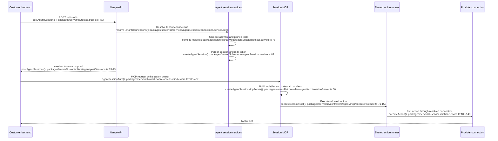

# Connection MCP to agent sessions

## What this is and why it exists

The Connection MCP is the legacy, per-connection MCP surface. A client sends an environment API key in `Authorization`, then identifies one connection with the `connection-id` and `provider-config-key` headers. Nango builds an MCP server for that connection and exposes the connection's available action functions. The public route is `POST /mcp`; the route requires the `environment:mcp` scope. [`packages/server/lib/routes.public.ts:426-429`](../packages/server/lib/routes.public.ts:426-429)

Agent sessions are a newer, scoped MCP surface. The customer's backend creates a session by declaring two things separately: which connections the agent may act on, and which action tools it may use. Nango resolves and stores that scope, returns a short-lived session token and an MCP URL, and the agent uses only that session token at the MCP endpoint. [`packages/server/lib/controllers/agent/postSessions.ts:13-75`](../packages/server/lib/controllers/agent/postSessions.ts:13-75)

The migration is therefore a change in ownership and lifecycle, not just an endpoint replacement. With Connection MCP, the client supplies a connection at request time and receives one connection's action names. With agent sessions, the backend creates an immutable, expiring capability before the agent connects. The session can cover one or many integrations, and its toolset is an explicit allowlist when least privilege is required.

The action runner is shared. Both MCP surfaces eventually call `executeAction`, so the provider authentication and orchestrator path remain familiar. The transport-specific layers still differ in authorization, tool naming, discovery, retries, errors, and session lifecycle. [`packages/server/lib/services/action.service.ts:36-41`](../packages/server/lib/services/action.service.ts:36-41)

## Vocabulary

- **Connection MCP** — the legacy `POST /mcp` endpoint that exposes tools for the single connection named by request headers.
- **Agent session** — a database-backed, expiring scope containing resolved connections, a compiled toolset, and enabled Nango meta tools.
- **Integration ID** — the Nango environment's `provider_config_key`, such as `github` or `notion`. Agent-session requests use this value in `toolset` and connection pins.
- **Pinned tool** — an allowed action that is also included in the session's `tools/list` response.
- **Searchable tool** — an allowed action that can be called, but is omitted from `tools/list`; the agent finds it through `nango_tool_search` and calls it through `nango_execute`.
- **Meta tool** — a Nango-provided control tool such as `nango_tool_search`, `nango_execute`, `nango_proxy`, or `nango_create_connection`.
- **Catalog action** — an action supplied by Nango's catalog rather than by a deployed sync-config row. It is represented in listings with `source: 'tools-catalog'` and `id: null`.

## The moving parts

| File | Role |
|---|---|
| [`packages/server/lib/routes.public.ts:426-429`](../packages/server/lib/routes.public.ts:426-429) | Registers the legacy Connection MCP endpoint and its environment permission. |
| [`packages/server/lib/controllers/mcp/connectionTools.ts:20-58`](../packages/server/lib/controllers/mcp/connectionTools.ts:20-58) | Validates the connection headers, loads the connection, and creates the legacy MCP transport. |
| [`packages/server/lib/controllers/mcp/connectionToolsServer.ts:22-67`](../packages/server/lib/controllers/mcp/connectionToolsServer.ts:22-67) | Lists legacy tools and installs the legacy `tools/call` handler. |
| [`packages/shared/lib/services/functions/legacy/service.ts:67-100`](../packages/shared/lib/services/functions/legacy/service.ts:67-100) | Returns deployed and, when enabled for the account, catalog action listings. Disabled deployed actions are included for callers to filter. |
| [`packages/server/lib/services/action.service.ts:42-152`](../packages/server/lib/services/action.service.ts:42-152) | Shared action lookup, disabled check, logging, orchestration, usage reporting, and error result. |
| [`packages/server/lib/routes.public.ts:471-477`](../packages/server/lib/routes.public.ts:471-477) | Registers session creation, termination, and the session MCP endpoint. |
| [`packages/server/lib/controllers/agent/postSessions.ts:13-75`](../packages/server/lib/controllers/agent/postSessions.ts:13-75) | Validates a session request and returns the session ID, token, MCP URL, and compiled summary. |
| [`packages/server/lib/services/agentSessionConnections.service.ts:78-130`](../packages/server/lib/services/agentSessionConnections.service.ts:78-130) | Resolves tag selectors and pinned connections to exactly one connection per integration. |
| [`packages/server/lib/services/agentSessionToolset.service.ts:69-173`](../packages/server/lib/services/agentSessionToolset.service.ts:69-173) | Converts the requested allow/deny policy into pinned and searchable action lists. |
| [`packages/server/lib/services/agentSession.service.ts:89-118`](../packages/server/lib/services/agentSession.service.ts:89-118) | Persists the resolved session scope. |
| [`packages/server/lib/services/agentSession.service.ts:207-260`](../packages/server/lib/services/agentSession.service.ts:207-260) | Creates and resolves the bearer token associated with the session. |
| [`packages/server/lib/controllers/agent/mcp/sessionMcp.ts:8-25`](../packages/server/lib/controllers/agent/mcp/sessionMcp.ts:8-25) | Creates the MCP server for an authenticated session request. |
| [`packages/server/lib/controllers/agent/mcp/sessionServer.ts:60-153`](../packages/server/lib/controllers/agent/mcp/sessionServer.ts:60-153) | Exposes meta tools, pinned tools, paginated listing, and callable searchable tools. |
| [`packages/server/lib/controllers/agent/mcp/execute/execute.ts:71-158`](../packages/server/lib/controllers/agent/mcp/execute/execute.ts:71-158) | Verifies session membership and connection availability, then invokes the shared action runner. |

## The flow

The main path below follows the least-privilege migration: one existing Connection MCP connection becomes one pinned connection in an agent session, and the existing action set becomes an explicit tool allowlist.



## The code path, step by step

### Connection MCP

1. **The route authenticates an environment API key.** `POST /mcp` uses `envAuth`, then requires `environment:mcp`. `envAuth` is secret-key authentication, rate limiting, egress metering, and environment resolution. [`packages/server/lib/routes.public.ts:133-136`](../packages/server/lib/routes.public.ts:133-136) [`packages/server/lib/middleware/access.middleware.ts:155-168`](../packages/server/lib/middleware/access.middleware.ts:155-168)

2. **The request identifies one connection.** `postConnectionToolsMcp` requires both `connection-id` and `provider-config-key`, looks up the connection within the authenticated environment, and returns `unknown_connection` if the pair is invalid. [`packages/server/lib/controllers/mcp/connectionTools.ts:13-42`](../packages/server/lib/controllers/mcp/connectionTools.ts:13-42)

3. **Nango creates a server around that connection.** The server loads the provider configuration and calls `legacyFunctionService.listActions`. That list is captured in the closure used by both `tools/list` and `tools/call`, so the tool inventory is selected when the MCP server is created. [`packages/server/lib/controllers/mcp/connectionToolsServer.ts:22-67`](../packages/server/lib/controllers/mcp/connectionToolsServer.ts:22-67)

4. **The legacy tool list is unqualified.** Each valid action is advertised under its action name alone, such as `delete-repository`. Disabled actions are removed from `tools/list`, and actions with a non-object or unreadable input schema are skipped. [`packages/server/lib/controllers/mcp/connectionToolsServer.ts:52-93`](../packages/server/lib/controllers/mcp/connectionToolsServer.ts:52-93)

5. **A tool call is resolved against the captured action list.** If the name was not in that list, the server returns `tool_not_available`. Otherwise it passes the connection ID, integration ID, action name, arguments, `isAsync: false`, and `retryMax: 3` to the shared runner. [`packages/server/lib/controllers/mcp/connectionToolsServer.ts:96-140`](../packages/server/lib/controllers/mcp/connectionToolsServer.ts:96-140)

6. **The shared runner re-checks the action.** It loads the connection and provider, resolves the action as either a deployed action or a catalog action, rejects a disabled deployed action, creates the operation log, and invokes the orchestrator. [`packages/server/lib/services/action.service.ts:65-115`](../packages/server/lib/services/action.service.ts:65-115)

7. **The legacy response is plain text JSON.** A successful result is serialized from `result.data`; action failures are converted into an MCP error with a generic Nango error code and a safe failure detail. [`packages/server/lib/controllers/mcp/connectionToolsServer.ts:141-191`](../packages/server/lib/controllers/mcp/connectionToolsServer.ts:141-191)

### Agent session creation

1. **The customer backend creates the capability.** `POST /sessions` uses an environment API key with `environment:agent_sessions:write`. The body must contain `tenant.connections`; `toolset`, `pinned_tools`, `meta_tools`, and `expires_in` are optional. [`packages/server/lib/routes.public.ts:471-474`](../packages/server/lib/routes.public.ts:471-474) [`packages/server/lib/controllers/agent/postSessions.ts:13-45`](../packages/server/lib/controllers/agent/postSessions.ts:13-45)

2. **Nango resolves the tenant's connections before creating the session.** `any` selectors are ORed with one another and AND their tags internally. Each resulting integration must resolve to at most one connection. A `pinned` entry names an exact integration and connection ID. Ambiguity, an unknown pin, or a pin that does not match the selectors fails creation rather than leaving the choice to a later tool call. [`packages/server/lib/services/agentSessionConnections.service.ts:78-130`](../packages/server/lib/services/agentSessionConnections.service.ts:78-130)

3. **Nango compiles the toolset.** It loads deployed functions and catalog actions, rejects unknown names and non-action functions, applies each integration's allow/deny policy, and separates the survivors into `pinned` and `searchable`. An explicit allowlist is the important security boundary; `pinned_tools` only controls which allowed tools are listed immediately. [`packages/server/lib/services/agentSessionToolset.service.ts:78-173`](../packages/server/lib/services/agentSessionToolset.service.ts:78-173)

4. **The compiled result is stored, not recomputed on every MCP request.** The session row stores the resolved connections, compiled toolset, meta-tool configuration, and expiration. A token is created through the keystore and associated with the session. [`packages/server/lib/services/agentSessionCreation.service.ts:243-297`](../packages/server/lib/services/agentSessionCreation.service.ts:243-297) [`packages/server/lib/services/agentSession.service.ts:89-118`](../packages/server/lib/services/agentSession.service.ts:89-118)

5. **The backend receives the MCP URL and session token.** The response includes `session_id`, `session_token`, `mcp_url`, `expires_at`, and summaries of the resolved toolset and meta tools. The session token is the credential intended for the agent; the environment API key should remain in the customer's backend. [`packages/server/lib/controllers/agent/postSessions.ts:63-73`](../packages/server/lib/controllers/agent/postSessions.ts:63-73)

### Agent session MCP requests

1. **The MCP request authenticates only with the session token.** `agentSessionAuth` validates the token format, resolves the session from the keystore, rejects ended or expired sessions, and puts the account, environment, plan, and session in request locals. An environment API key is not accepted at this endpoint. [`packages/server/lib/middleware/access.middleware.ts:341-382`](../packages/server/lib/middleware/access.middleware.ts:341-382) [`packages/server/lib/middleware/access.middleware.ts:385-427`](../packages/server/lib/middleware/access.middleware.ts:385-427)

2. **The URL and token must belong to the same session.** The controller compares the URL's `sessionId` with the authenticated session ID before creating the server. A token from session A cannot be used against session B's URL. [`packages/server/lib/controllers/agent/mcp/sessionMcp.ts:8-25`](../packages/server/lib/controllers/agent/mcp/sessionMcp.ts:8-25)

3. **The server registers all callable tools but lists only the visible subset.** Enabled meta tools and pinned action tools are included in `tools/list`. Searchable action tools are registered and callable but deliberately omitted from the list. Listing is paginated at 50 tools per page. [`packages/server/lib/controllers/agent/mcp/sessionServer.ts:79-153`](../packages/server/lib/controllers/agent/mcp/sessionServer.ts:79-153)

4. **Action tool names are qualified.** A Connection MCP action called `read_doc` is listed by an agent session as something like `notion__read_doc`. The integration ID and action are also put in `_meta`. Names are sanitized, clipped, and suffixed if sanitization creates a collision, so clients should use the exact returned slug rather than reconstructing it. [`packages/server/lib/controllers/agent/mcp/sessionServer.ts:17-28`](../packages/server/lib/controllers/agent/mcp/sessionServer.ts:17-28) [`packages/server/lib/controllers/agent/mcp/sessionServer.ts:216-269`](../packages/server/lib/controllers/agent/mcp/sessionServer.ts:216-269)

5. **A pinned action can be called directly.** The server maps the qualified name back to the integration and action, checks that the action is still in the session toolset, resolves the session connection, and invokes the shared runner with `retryMax: 0` and an actor identifying the session. [`packages/server/lib/controllers/agent/mcp/execute/execute.ts:92-147`](../packages/server/lib/controllers/agent/mcp/execute/execute.ts:92-147)

6. **A searchable action is discovered and called in two steps.** `nango_tool_search` searches only the compiled session toolset and returns the exact slug for `nango_execute`. `nango_execute` then checks that slug is callable in this session and passes its nested `input` through to the same action runner. [`packages/server/lib/controllers/agent/mcp/toolSearch/search.ts:11-24`](../packages/server/lib/controllers/agent/mcp/toolSearch/search.ts:11-24) [`packages/server/lib/controllers/agent/mcp/execute/execute.ts:23-55`](../packages/server/lib/controllers/agent/mcp/execute/execute.ts:23-55)

7. **The action runner remains shared but the transport behavior differs.** The agent-session path turns runner errors into session-specific MCP errors, records the session as the operation actor, and uses zero retries. The legacy path uses three retries and does not pass a session actor. [`packages/server/lib/controllers/agent/mcp/execute/execute.ts:128-158`](../packages/server/lib/controllers/agent/mcp/execute/execute.ts:128-158) [`packages/server/lib/controllers/mcp/connectionToolsServer.ts:129-145`](../packages/server/lib/controllers/mcp/connectionToolsServer.ts:129-145)

## What a migration looks like

### 1. Inventory the existing Connection MCP usage

For every client or agent, record:

- The integration ID from `provider-config-key`.
- The connection ID from `connection-id`.
- The action names the agent actually calls.
- Whether the client relies on every available action appearing in `tools/list`.
- Whether the client calls actions directly by name or lets an LLM choose from the tool list.
- Whether the client depends on legacy retry behavior or legacy error text.

There is no server-side conversion endpoint in the traced API. The migration is performed by the customer's backend: create the session, pass its MCP credentials to the agent, and stop constructing Connection MCP requests.

### 2. Choose how the session selects the connection

For a direct one-for-one migration, pin the existing connection:

```json
{
  "tenant": {
    "connections": {
      "pinned": [
        {
          "integration_id": "github",
          "connection_id": "github-acme"
        }
      ]
    }
  }
}
```

This is the closest equivalent to the legacy headers. It avoids relying on tags and still lets the session scope more integrations later. The pin is verified against the environment during session creation. [`packages/server/lib/services/agentSessionConnections.service.ts:95-130`](../packages/server/lib/services/agentSessionConnections.service.ts:95-130)

For a multi-tenant application, prefer tags when the application already tags connections by user, organization, or workspace. A selector such as `{ "tags": { "organization_id": "acme", "workspace": "marketing" } }` must resolve to exactly one connection per integration. If it matches two connections, session creation fails with `ambiguous_connections`. [`docs/guides/agent-sessions.mdx:296-360`](../docs/guides/agent-sessions.mdx:296-360)

### 3. Turn the real action usage into an explicit allowlist

If the old client uses two actions on `github`, create a session like this:

```json
{
  "tenant": {
    "connections": {
      "pinned": [
        {
          "integration_id": "github",
          "connection_id": "github-acme"
        }
      ]
    }
  },
  "toolset": {
    "github": {
      "allow": {
        "tools": ["get_issue", "create_issue"]
      }
    }
  },
  "pinned_tools": {
    "github": ["get_issue", "create_issue"]
  },
  "meta_tools": {
    "nango_tool_search": false,
    "nango_execute": false,
    "nango_proxy": false,
    "nango_create_connection": false
  },
  "expires_in": "1h"
}
```

The `toolset` is the permission boundary. `pinned_tools` makes the same actions visible to the MCP client immediately; it does not grant additional permission. If `pinned_tools` is omitted, the allowed actions become searchable rather than listed. The allow/deny semantics are implemented in `compileToolsetFromFunctions`. [`packages/server/lib/services/agentSessionToolset.service.ts:30-53`](../packages/server/lib/services/agentSessionToolset.service.ts:30-53) [`packages/server/lib/services/agentSessionToolset.service.ts:142-172`](../packages/server/lib/services/agentSessionToolset.service.ts:142-172)

Do not omit `toolset` if the goal is to preserve a narrow Connection MCP surface. An omitted `toolset` covers every integration for which the tenant resolved a connection. An explicit top-level `"*"` covers every integration in the environment, including disconnected ones. [`packages/server/lib/services/agentSessionToolset.service.ts:69-76`](../packages/server/lib/services/agentSessionToolset.service.ts:69-76)

### 4. Move session creation into the backend

The backend uses its environment API key to call `POST /sessions`, then passes only the returned `mcp_url` and `session_token` to the agent. The session-create API requires the `environment:agent_sessions:write` scope. [`docs/guides/agent-sessions.mdx:28-64`](../docs/guides/agent-sessions.mdx:28-64)

The old client configuration conceptually changes as follows:

| Connection MCP | Agent sessions |
|---|---|
| MCP URL: `https://api.nango.dev/mcp` | MCP URL: the returned `mcp_url`, such as `https://api.nango.dev/session/<id>/mcp` |
| `Authorization: Bearer <environment API key>` | `Authorization: Bearer <session token>` |
| `connection-id: <connection ID>` | Connection pin or tag selector in `POST /sessions` |
| `provider-config-key: <integration ID>` | Integration key in `tenant`, `toolset`, and `pinned_tools` |
| One connection per MCP server | One or many resolved integrations per session |
| Long-lived API-key access | Expiring, revocable session capability |

The agent should never receive the environment API key. Agent-session authentication rejects an environment API key at the session MCP endpoint, which also prevents accidentally treating a broad environment credential as a session credential. [`packages/server/lib/controllers/agent/mcp/sessionMcp.integration.test.ts:231-238`](../packages/server/lib/controllers/agent/mcp/sessionMcp.integration.test.ts:231-238)

### 5. Update tool discovery and invocation

There are two compatible migration choices:

1. **Preserve direct MCP tool calls.** Add every allowed action to `pinned_tools`. Update stored tool names from `action_name` to the exact qualified names returned by `tools/list`, for example `github__create_issue`. Keep the relevant meta tools disabled if the agent should have no discovery or proxy escape hatch.
2. **Use agent-session discovery.** Put actions in `toolset` but not `pinned_tools`. Leave `nango_tool_search` and `nango_execute` enabled, which are their defaults. The agent searches for an operation, then calls `nango_execute` with the returned slug and input. [`docs/guides/agent-sessions.mdx:364-441`](../docs/guides/agent-sessions.mdx:364-441)

Do not enable `nango_proxy` as a blind replacement for missing actions. It can reach any endpoint of a connected integration, not only the actions in the toolset, which is why it is disabled by default. Enable it only when that broader provider API access is intended. [`packages/server/lib/controllers/agent/mcp/proxy/proxy.ts:23-59`](../packages/server/lib/controllers/agent/mcp/proxy/proxy.ts:23-59)

If the old flow relied on actions that are not directly visible to the model, agent-session search is the closest replacement. Search returns the action's integration, action name, exact call slug, connection status, and input information when the schema can be read. [`packages/server/lib/services/agentSessionToolSearch.service.ts:231-319`](../packages/server/lib/services/agentSessionToolSearch.service.ts:231-319)

### 6. Add session lifecycle handling

Connection MCP does not require the customer to manage a separate session resource. Agent sessions do. A session is immutable, expires according to `expires_in`, and can be terminated early with `DELETE /sessions/{session_id}`. Termination revokes the session token, but does not cancel a tool call already in flight. [`docs/guides/agent-sessions.mdx:262-294`](../docs/guides/agent-sessions.mdx:262-294)

The customer backend should therefore:

- Create a session at the boundary where an agent task starts.
- Keep the session token server-side or pass it only through the agent provider's MCP authorization field.
- Recreate the session when it expires; sessions cannot be extended.
- Terminate the session when the task ends early or access must be revoked.
- Avoid persisting a session token as if it were a permanent connection credential.

## Important behavioral differences

| Concern | Connection MCP | Agent sessions | Migration consequence |
|---|---|---|---|
| Authentication | Environment API key plus connection headers. [`packages/server/lib/routes.public.ts:426-429`](../packages/server/lib/routes.public.ts:426-429) | Session bearer token; URL and token must match. [`packages/server/lib/middleware/access.middleware.ts:385-427`](../packages/server/lib/middleware/access.middleware.ts:385-427) | Add backend session creation and token refresh/recreation. |
| Scope | One connection, with the action inventory selected from that integration. [`packages/server/lib/controllers/mcp/connectionTools.ts:27-42`](../packages/server/lib/controllers/mcp/connectionTools.ts:27-42) | One or many connections and an immutable toolset. [`packages/server/lib/services/agentSession.service.ts:25-45`](../packages/server/lib/services/agentSession.service.ts:25-45) | Model tenant selection and action authorization separately. |
| Tool names | Action name only, such as `read_doc`. [`packages/server/lib/controllers/mcp/connectionToolsServer.ts:70-93`](../packages/server/lib/controllers/mcp/connectionToolsServer.ts:70-93) | Qualified and sanitized, such as `notion__read_doc`. [`packages/server/lib/controllers/agent/mcp/sessionServer.ts:216-251`](../packages/server/lib/controllers/agent/mcp/sessionServer.ts:216-251) | Update hard-coded names and prompts. |
| Discovery | All enabled, schema-compatible actions are listed. [`packages/server/lib/controllers/mcp/connectionToolsServer.ts:52-63`](../packages/server/lib/controllers/mcp/connectionToolsServer.ts:52-63) | Only pinned tools are listed; searchable tools require meta tools. [`packages/server/lib/controllers/agent/mcp/sessionServer.ts:94-113`](../packages/server/lib/controllers/agent/mcp/sessionServer.ts:94-113) | Pin the exact set for old direct-call behavior, or update the agent flow to search and execute. |
| Action input schema | The legacy tool descriptor projects the action's object schema into the MCP tool. [`packages/server/lib/controllers/mcp/connectionToolsServer.ts:70-93`](../packages/server/lib/controllers/mcp/connectionToolsServer.ts:70-93) | Pinned integration tools are registered with a free-form object schema; search exposes the deployed input schema for a best match. [`packages/server/lib/controllers/agent/mcp/sessionServer.ts:37-54`](../packages/server/lib/controllers/agent/mcp/sessionServer.ts:37-54) [`packages/server/lib/services/agentSessionToolSearch.service.ts:272-318`](../packages/server/lib/services/agentSessionToolSearch.service.ts:272-318) | Test how the particular MCP client handles the new schema and preserve application-side validation if needed. |
| Retry behavior | Calls the shared runner with `retryMax: 3`. [`packages/server/lib/controllers/mcp/connectionToolsServer.ts:129-140`](../packages/server/lib/controllers/mcp/connectionToolsServer.ts:129-140) | Calls it with `retryMax: 0`. [`packages/server/lib/controllers/agent/mcp/execute/execute.ts:20-21`](../packages/server/lib/controllers/agent/mcp/execute/execute.ts:20-21) | Do not assume transient failures will be retried the same way. |
| Action actor | No agent-session actor is passed. [`packages/server/lib/controllers/mcp/connectionToolsServer.ts:129-140`](../packages/server/lib/controllers/mcp/connectionToolsServer.ts:129-140) | Operation actor is `{ kind: 'session', id: session.id }`. [`packages/server/lib/controllers/agent/mcp/execute/execute.ts:137-147`](../packages/server/lib/controllers/agent/mcp/execute/execute.ts:137-147) | Log and audit correlation changes; use the session ID when diagnosing calls. |
| Revocation | Revoke or rotate the API credential or remove access to the connection/environment. | Delete the session; token resolution then fails because the session is ended. [`packages/server/lib/services/agentSession.service.ts:140-167`](../packages/server/lib/services/agentSession.service.ts:140-167) | Add explicit session termination to the application lifecycle. |

## Catalog actions and the disabled-state change

The current checkout already contains the infrastructure for catalog actions, but it is feature-flagged. `hasCatalogTools` is backed by the `tools-catalog` flag and defaults to false. When enabled, the legacy function listing merges catalog actions with deployed actions, and the session inventory does the same. [`packages/feature-flags/lib/flags.ts:77-82`](../packages/feature-flags/lib/flags.ts:77-82) [`packages/shared/lib/services/functions/legacy/models/functions.ts:77-119`](../packages/shared/lib/services/functions/legacy/models/functions.ts:77-119) [`packages/shared/lib/services/functions/legacy/models/functions.ts:205-260`](../packages/shared/lib/services/functions/legacy/models/functions.ts:205-260)

The current code still has a disabled concept in three relevant places:

- Connection MCP filters disabled actions from `tools/list`. [`packages/server/lib/controllers/mcp/connectionToolsServer.ts:52-63`](../packages/server/lib/controllers/mcp/connectionToolsServer.ts:52-63)
- Agent-session compilation excludes deployed rows whose `enabled` value is false. [`packages/server/lib/services/agentSessionToolset.service.ts:305-326`](../packages/server/lib/services/agentSessionToolset.service.ts:305-326)
- Shared execution returns `disabled_action` for a deployed disabled row. [`packages/server/lib/services/action.service.ts:77-84`](../packages/server/lib/services/action.service.ts:77-84)

That means the planned product change is broader than changing the Connection MCP list. To make the disabled concept truly cease to exist, the action inventory, session compiler, execution path, and any management/UI operation that toggles `enabled` must agree on the new model. The migration recommendation should be written against the post-change model: do not attempt to preserve disabled actions as a hidden deny mechanism. Put the actions an agent may use in the session's explicit allowlist instead.

One subtlety is precedence. If a deployed action has the same name as a catalog action, the deployed row occupies that name and the catalog action is not appended. [`packages/shared/lib/services/functions/legacy/models/functions.ts:225-238`](../packages/shared/lib/services/functions/legacy/models/functions.ts:225-238) The migration should therefore inventory the names actually returned for each integration, not assume the catalog definition wins.

## Recommended rollout

1. **Build an action inventory.** Use the existing Connection MCP `tools/list` calls and application logs to identify integrations and actions actually used, including actions called directly by name.
2. **Create a session adapter.** For one client, pin its current connection and explicitly allow only its used actions. Pin those same actions initially so the client receives a familiar list-like experience.
3. **Change the MCP credentials.** Replace the legacy URL, environment API key, and connection headers with the returned `mcp_url` and session bearer token. Keep API-key use in the backend.
4. **Update tool names.** Replace unqualified action names with the exact names from the session's `tools/list`; if using searchable tools, update the agent instructions to call `nango_tool_search` followed by `nango_execute`.
5. **Test the behavior.** Verify tool listing, input handling, successful execution, action failure, unknown tool handling, connection selection, session expiry, and session termination. Explicitly test a catalog action and an action that was previously disabled during the breaking-change rollout.
6. **Run a short dual path.** For clients that can tolerate it, create the session and compare the tool inventory and results in a staging or shadow path before switching the production MCP URL.
7. **Remove the legacy path.** After the four-week removal date, delete Connection MCP client configuration and any application code that sends `connection-id` or `provider-config-key` to `/mcp`.

## Conditions, branches, and edge cases

- **A session can include an unconnected integration.** An explicit toolset can include an integration for which no connection was resolved. The tools are listed or searchable, but calls fail with `integration_not_connected` until a connection exists. [`packages/server/lib/controllers/agent/mcp/execute/execute.ts:117-125`](../packages/server/lib/controllers/agent/mcp/execute/execute.ts:117-125)
- **Connection selection is strict at creation.** Ambiguous selectors fail the entire session. There is no per-call choice between matching connections. [`packages/server/lib/services/agentSessionConnections.service.ts:198-225`](../packages/server/lib/services/agentSessionConnections.service.ts:198-225)
- **Session scope is immutable.** Changing the allowlist or connections means creating a new session; the stored compiled toolset is not rebuilt from the latest environment state. [`packages/server/lib/services/agentSession.service.ts:25-45`](../packages/server/lib/services/agentSession.service.ts:25-45)
- **The runtime still detects stale actions.** On the current code, an action removed or disabled after session creation can remain in the compiled session but fail during execution. The session integration test follows this path explicitly. [`packages/server/lib/controllers/agent/mcp/sessionMcp.integration.test.ts:341-380`](../packages/server/lib/controllers/agent/mcp/sessionMcp.integration.test.ts:341-380)
- **Tool names can collide after sanitization.** The session server numbers later collisions, so a client must not derive a name from raw integration and action strings. [`packages/server/lib/controllers/agent/mcp/sessionServer.ts:250-269`](../packages/server/lib/controllers/agent/mcp/sessionServer.ts:250-269)
- **Meta tools are policy decisions.** `nango_tool_search` and `nango_execute` default on; `nango_proxy` and `nango_create_connection` default off. A migration should set these explicitly when the security posture must not depend on defaults. [`packages/server/lib/services/agentSessionCreation.service.ts:64-79`](../packages/server/lib/services/agentSessionCreation.service.ts:64-79) [`packages/server/lib/services/agentSessionCreation.service.ts:300-329`](../packages/server/lib/services/agentSessionCreation.service.ts:300-329)
- **Creating a connection is a different flow.** If the old application always preconnected users, leave `nango_create_connection` off. If the agent should ask the user to authorize a missing integration, enable it and configure its tags; Nango then binds the new connection back to the session. [`packages/server/lib/controllers/agent/mcp/createConnection/createConnection.ts:17-101`](../packages/server/lib/controllers/agent/mcp/createConnection/createConnection.ts:17-101)

## Worth its own dive

This document traces the main successful path and the migration-relevant branches. The following areas were mapped but not followed line by line:

- The full Connect UI and OAuth flow for creating or reconnecting the pinned connections.
- Provider-specific proxy behavior behind `nango_proxy`.
- The orchestrator's synchronous timeout and retry implementation below `executeAction`.
- The cron path that expires old sessions and the keystore cleanup details.
- MCP-client-specific configuration for OpenAI, Anthropic, Vercel AI SDK, LangChain, and Mastra.

The most important implementation conclusion is that the customer-facing migration should be designed around a backend-created, explicitly allowlisted session. Ask for a line-by-line expansion of any step above if a client integration or a planned disabled-state change needs a deeper review.
