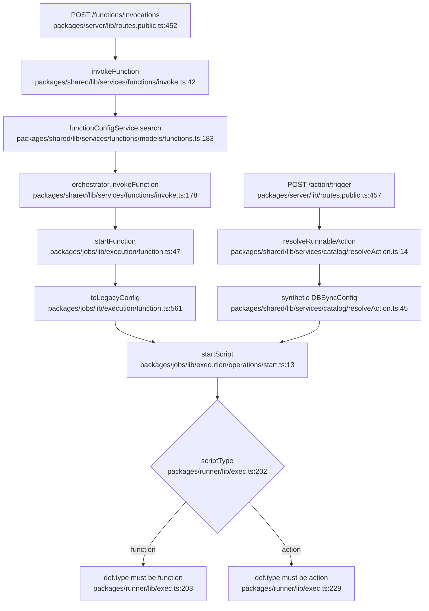

# Functions, sync configs, and a tools catalog

`.deep-understand/` can be gitignored. This file is a working note, not a commit.

The path traced end to end is a **deployed new function** being invoked. That is the execution model a tools catalog should join. The legacy action path, including `resolveRunnableAction`, is a side branch: named, anchored, and not followed line by line past the resolver.

## What this is and why it exists

Nango is mid-transition. The things the dashboard and `GET /integrations/:uniqueKey/functions` call "functions" are still rows in `_nango_sync_configs`: a sync, an action, or an on-event script. A second model is being written beside that one. Its rows live in `function_configs`, `function_config_versions`, and `function_instances`. A function there is one primitive that can be invoked, scheduled, or woken by an event, depending on a `trigger` field. Syncs, tools, and event handlers are uses of that primitive, not separate tables.

The live-catalog work on this stack reads prebuilt actions out of `flows.zero.json` and, when no deployed action has that name, fabricates a `DBSyncConfig` so the old action runner can execute it. That fabrication is the same kind of adapter the new function runner already has, except the new one is marked temporary and sits at the jobs boundary. Putting a fake sync config in the catalog reader grows the old type at the place the new model is supposed to replace.

## Vocabulary

**Sync config.** A row in `_nango_sync_configs`. `type` is `'action' | 'sync' | 'on-event'`. This is the old stored definition: file location, models, endpoint-era metadata, enabled, source. `DBSyncConfig` in `packages/types/lib/syncConfigs/db.ts`.

**Function config.** A row in `function_configs`: name, integration, environment, enabled, and a pointer at the current version. It is not a script. The script and the behavior live on the version.

**Function version.** A row in `function_config_versions`. `trigger` says how it starts. `requires`, `capabilities`, `limits`, and schema refs say what it is allowed to do. `file_location` is the compiled JS. `source` is still `'catalog' | 'standalone' | 'repo'`, the same enum as a sync config.

**Function instance.** A row in `function_instances`, one per connection (and variant). Schedule state lives here (`frequency`, `last_run_at`). An invoke does not look up an instance.

**Trigger kind.** On a function version: `none`, `schedule`, `http`, or `event`. This replaces the old split of sync vs action vs on-event. It is not the same word as "trigger an action."

**Tool.** Not a type in the repo. In the review on the catalog reader it means the new-world name for something you call: a function whose job is to be invoked, rather than a legacy action.

**Catalog action.** What this branch reads from `flows.zero.json`. A legacy action template: name, description, scopes, an input model, output models, an optional HTTP endpoint, JSON schema. The compiled file is a zero-yaml module whose `type` is `'action'`.

**`NangoProps.syncConfig`.** The bag the runner still requires. Both the action job and the function job fill it with a `DBSyncConfig` before `startScript`. For a real function that object is built in memory and is not the row that was loaded.

## The moving parts

| File | Role |
|---|---|
| `packages/database/lib/migrations/20260729120000_create_function_tables.cjs` | Creates the three function tables |
| `packages/types/lib/function/config.ts` | Trigger, capabilities, limits, requires |
| `packages/types/lib/function/db.ts` | Row types for config, version, instance |
| `packages/types/lib/syncConfigs/db.ts` | `DBSyncConfig`, the old row |
| `packages/types/lib/runner/sdk.ts` | `NangoProps`; `syncConfig` is still a `DBSyncConfig` |
| `packages/shared/lib/services/functions/invoke.ts` | Loads a deployed function and calls the orchestrator |
| `packages/jobs/lib/execution/function.ts` | Jobs entry for a function task; builds the legacy config |
| `packages/jobs/lib/execution/operations/start.ts` | Loads the script and invokes the runtime |
| `packages/runner/lib/exec.ts` | Dispatches on `scriptType` and on the module's `type` |
| `packages/shared/lib/services/catalog/resolveAction.ts` | This branch: deployed action, else a synthetic sync config |
| `packages/shared/lib/services/catalog/actions.ts` | Reads `flows.zero.json` actions into `CatalogAction` |

## The flow

## The code path, step by step

1. `POST /functions/invocations` lands in `postFunctionInvocation` and calls `invokeFunction` with the account, environment, integration id, connection id, function name, input, and `invocation_type` (`wait` or `no_wait`).

2. `invokeFunction` loads the connection, then `functionConfigService.search` for that environment, integration key, and name. The query joins `function_configs` to the current `function_config_versions` row and drops soft-deleted rows. Zero rows or more than one is `function_not_found`. A disabled config is `function_disabled`. There is no catalog fallback.

3. `supportInvocation` decides whether this version may be called that way (`packages/shared/lib/services/functions/invoke.ts:255`). `http` allows `wait` and `no_wait`. `schedule` and `event` allow only `no_wait`. `none` allows nothing. The type comment says `none` is "invoke-only" (`packages/types/lib/function/config.ts:32`). The function rejects it. I did not find a caller that invokes a `none` trigger.

4. Input is validated against the version's JSON schema. `buildRuntimeTrigger` then builds the object the script's `exec` receives. For `http`, the input becomes both `trigger.input` and `request.body`. The log row stores `syncConfig: { id: currentVersion.id, name: config.name }`. The id is a version id, not a sync-config id. The orchestrator is called with `functionConfigId` and `functionName`.

5. The jobs processor sends `task.isFunction()` to `startFunction`. That loads the same search by `functionConfigId` and name. A miss throws `Function not found`. Disabled throws `Function is disabled`.

6. `toLegacyConfig` is the adapter. It returns a `DBSyncConfig` that was never inserted: `id` is the version id, `sync_name` is the function name, `type` is hardcoded `'action'`, `models` is `[]`, `sdk_version` is `null`, `features` is `['checkpoints']` only when `capabilities.usesCheckpoints`. The comment on the function is `TODO: refactor NangoProps to support native function config`. The `type: 'action'` line has its own TODO: change it when the runner SDK supports `'function'`.

7. `startFunction` sets `nangoProps.scriptType` to `'function'` and `nangoProps.syncConfig` to that object, then calls `startScript`. `startScript` reads two fields off the sync config: `file_location` (where to load the JS) and `sync_name` (the error string and the trace tag). Everything else on `DBSyncConfig` is for the runner props, which the jobs schema still validates as a full sync-config object, including `type: 'sync' | 'action' | 'on-event'`. `'function'` is not a legal `syncConfig.type` there, which is why step 6 lies.

8. The runner wraps the file and looks at `exports.default`. For `scriptType === 'function'` the module must be zero-yaml and `def.type` must be `'function'`, and it calls `def.exec`. Any other module throws `Failed to load function`.

## How a sync config differs

A sync config is one row that is both the identity and the script. `type` picks the product: sync, action, or on-event. Scheduling is `runs` plus `auto_start`. HTTP exposure for an action is an endpoint on the template, not a column I saw on `DBSyncConfig` itself. Models are `models` / `models_json_schema`. Deletes are a boolean (`track_deletes`, `deleted`).

A function splits that into three rows. Identity and enablement are the config. The script, trigger, and schemas are the version, so a new deploy can point `current_version_id` at a new row without a new name. Per-connection schedule state is the instance, created on deploy when `artifact.trigger.kind === 'schedule'`. Soft delete is `deleted_at` on each table, not a `deleted` boolean.

The old `type` does not exist on a function. What used to be "an action" is a trigger you can call. What used to be "a sync" is `trigger.kind === 'schedule'` plus capabilities like `usesRecords` and `usesCheckpoints`. What used to be "an on-event" is `trigger.kind === 'event'` with a list of `OnEventType`. One function version has one trigger kind.

`GET /integrations/:uniqueKey/functions` does not read `function_configs`. It calls `legacyFunctionService.listFunctions`, which reads sync configs. The new invoke route is a different URL. The word "functions" on that list endpoint is the old set.

## The catalog branch

`listCatalogActions` maps `flows.zero.json` `integration.actions` into `CatalogAction`: name, description, scopes, input model, output models, `endpoint`, JSON schema, `sdk_version` set to `` `${integration.sdkVersion}-zero` ``. That is the old action template, not a function version.

`resolveRunnableAction` loads a deployed action with `getSyncConfigRaw`. If that misses and the flag is on, `toSyntheticSyncConfig` builds a `DBSyncConfig` with `id: 0`, `type: 'action'`, `source: 'catalog'`, and `file_location` under `templates-zero/`. Callers then run the legacy action job. The runner, given `scriptType: 'action'`, requires `def.type === 'action'`.

Those two checks are why a catalog action cannot be sent through `startFunction` unchanged. `startFunction` sets `scriptType: 'function'`, and the runner then requires `def.type === 'function'`. The files this catalog reads are action modules. I did not open a compiled `templates-zero` file; the requirement is the runner branch above plus `sdk_version` ending in `-zero`, which is what `exec` checks before it will run a zero-yaml module as an action.

## What would actually move this toward functions

Name the catalog entry a tool, and make that type the fields of a function version that are not a row: name, description, `file_location`, version, `trigger`, `requires`, `capabilities`, `limits`, schema refs, `json_schema`, `source: 'catalog'`. No `id`. No `DBSyncConfig`. `resolveRunnableTool` returns a deployed `CurrentFunctionConfig` or that tool. The fake sync config stays inside `toLegacyConfig`, which already exists for this reason.

Do not teach `startScript` a second config type. It barely reads the sync config. The object it needs is dictated by `NangoProps` and `nangoPropsSchema`, and the comment on `toLegacyConfig` already says that object should go away in favor of a native function config. A catalog tool should become an in-memory config plus version, then go through that one function.

Today's `flows.zero.json` actions only fill part of that type honestly:

| Catalog action field | Function version field | Fit |
|---|---|---|
| `name`, `description`, `version`, `json_schema`, file path | the same ideas | Direct |
| `features` containing `checkpoints` | `capabilities.usesCheckpoints` | Direct |
| `input` model name | `input_schema_ref` | Same slot, different meaning (model name vs schema ref) |
| `output` models | `model_schema_refs` | Same stretch |
| `endpoint`, `scopes` | nothing | Old. Leave them off the tool. The v1 proxy can keep its own lookup |
| `sdk_version` ending in `-zero` | not stored on a version | The action runner needs it. The function runner skips that check when `scriptType === 'function'` |

The trigger is the part that does not map cleanly. A catalog action is "call me with an input." The only trigger kind `invokeFunction` will run with input and `wait` is `http`. `none` is the documented invoke-only kind, and `supportInvocation` refuses it. Modeling a tool as `{ kind: 'none' }` matches the comment and will not run. Modeling it as `{ kind: 'http' }` will run and means "incoming HTTP," which is not what an action call is. That gap is in the new model; the catalog should not paper over it with a sync config.

So the step that matches the new world, and can run the files we have, is split:

- The shared type is a tool, shaped like a function version, with no sync-config fields.
- Execution of a tool whose module is `type: 'function'` goes through `startFunction` and `toLegacyConfig`.
- Execution of a tool whose module is still `type: 'action'` is a sibling of `toLegacyConfig` next to `startAction`, not a type the catalog reader exports. That sibling is what disappears when the template files are compiled as functions.

Listing those tools from `GET /integrations/:uniqueKey/functions` puts them on the legacy list. I did not find a public route that lists `function_configs`. A tools catalog that should not grow the old API wants its list on the new surface, once that surface exists.

## Conditions worth remembering

- Flag off in `resolveRunnableAction` returns `missing` before the catalog is read. Deployed action rows win, including disabled ones, because `getSyncConfigRaw` returns first.
- `invokeFunction` has no such fallback. A name with no `function_configs` row is `function_not_found`.
- `startScript` on this branch (the reader) still loads local files unless `isCloud` or `integrationFilesAreRemote`. The templates-zero remote read is on the triggers branch, not here.
- `toLegacyConfig` sets `deleted` nowhere; `DBSyncConfig` requires `deleted` via `TimestampsAndDeleted`. I did not check whether the returned object is missing `deleted` and only typechecks because of how the timestamps type is built. Worth a look before copying that function.

## Worth its own dive

- `supportInvocation` versus the `none` comment. I did not trace who writes `trigger.kind: 'none'` or whether invoke-only is unfinished.
- Deploy and reconcile (`packages/shared/lib/services/functions/deploy.ts`): how a bundle becomes config, version, and instance rows. I only read the schedule-instance branch.
- The orchestrator task types (`isFunction` vs `isAction`) and what `functionConfigId: 0` would do. I did not read the orchestrator package.
- Runner SDK: `createFunctionFacade` and why `toLegacyConfig` still sets `type: 'action'`. The TODO says the SDK does not accept `'function'` yet. I did not read that check.
- `GET /integrations/:uniqueKey/functions` pagination and the live-catalog union. That is the listing branch, not this one.

Any of those steps can be expanded line by line.
