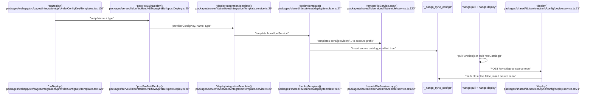

# Functions pipeline: catalog, repo, and standalone

`.deep-understand/` can be gitignored; this file is a working document, not a commit.

## What this is and why it exists

A Nango **function** is TypeScript that Nango compiles and runs against one connection's credentials. Before it can run, it has to become a row in `_nango_sync_configs` (compiled JS + TypeScript source in S3, plus metadata). That row has a `source` column: `catalog`, `repo`, or `standalone`. Source is not a runtime flag — jobs do not branch on it — it is an **ownership** label. It decides who is allowed to overwrite or delete the function, whether a CLI reconcile will delete it, and what the dashboard shows as "Nango" vs "your repo".

There are three ways to write that row, matching the three paths in the functions guide (`docs/guides/functions/functions-guide.mdx:38-45`):

1. **Enable a template** from the catalog. Nango copies a pinned snapshot of compiled JS and TS from the public S3 prefix into the account prefix and inserts `source: 'catalog'`.
2. **Deploy from a local CLI project.** The CLI compiles `createSync` / `createAction` files and posts them to `POST /sync/deploy` with `source: 'repo'` (the default).
3. **Deploy TypeScript over HTTP** (`POST /functions/deployments` with `type: "function"`). An agent sandbox runs the same CLI deploy with `NANGO_DEPLOY_SOURCE=standalone`.

`nango pull` does not change source. It only writes files locally. Ownership flips when you **redeploy** that code through the CLI, which inserts a new `_nango_sync_configs` row with `source: 'repo'` and marks the old catalog/standalone row inactive.

This document traces that ownership mechanism. The main path is: **deploy a catalog template, pull it, CLI-deploy it, and watch source become `repo`**. The other two write paths are mapped as entries into the same table.

## Vocabulary

- **Function / sync config** — an active row in `_nango_sync_configs`. Historically named "sync config" even for actions. `type` is `'sync'` or `'action'`.
- **Template** — catalog metadata plus files. Not deployed. Lives in `packages/shared/flows.zero.json` (schemas, versions, endpoints) and in S3 under `templates-zero/{provider}/`. The GitHub repo `NangoHQ/integration-templates` is the human-readable TS source; S3 is what `deployTemplate` copies.
- **`source`** — Postgres enum `sync_config_source`: `'catalog' | 'standalone' | 'repo'` (`packages/types/lib/syncConfigs/db.ts:8`). Replaced the booleans `pre_built` / `is_public` (migration `packages/database/lib/migrations/20260417120000_sync_config_code_source.cjs:10-23`).
- **Catalog deploy** — copy from `templates-zero/` into the account prefix, insert `source: 'catalog'`.
- **Repo deploy** — CLI `nango deploy` of `createSync`/`createAction` files via `POST /sync/deploy`. Default `source: 'repo'`.
- **Standalone deploy** — same `POST /sync/deploy` path, but `source: 'standalone'`, set by `NANGO_DEPLOY_SOURCE` when the sandbox CLI runs. Intended for agents, not humans.
- **Take ownership** — CLI-deploy a function that already exists as catalog or standalone. New row is `repo`; old row is `active: false`. Syncs (`_nango_syncs`) are retargeted onto the new config id.
- **Reconcile** — after a CLI deploy with `reconcile: true`, delete `_nango_sync_configs` rows that are `source: 'repo'` and missing from the payload. Catalog and standalone are excluded from this sweep.
- **Legacy vs native functions** — `createSync`/`createAction` still land in `_nango_sync_configs` (this document). Experimental `createFunction` lands in a different table via `POST /functions/deployments/bundle` and always writes `source: 'repo'` there. Catalog templates are `createSync`/`createAction`. See "Worth its own dive".

## The moving parts

| File | Role |
|---|---|
| `packages/types/lib/syncConfigs/db.ts:8` | `FunctionSource` union |
| `packages/server/lib/services/flow.service.ts:10` | Loads `flows.zero.json`; lookup by provider + name + type |
| `packages/shared/lib/services/file/remote.service.ts:56` | S3 copy from `templates-zero/` into the account prefix |
| `packages/shared/lib/services/deploy/template.ts:27` | Catalog copy + insert `source: 'catalog'` |
| `packages/server/lib/services/integrationTemplate.service.ts:29` | Resolves template, plan/trial check, deploy, trigger syncs |
| `packages/server/lib/controllers/v1/flows/preBuilt/postDeploy.ts:20` | Dashboard `POST /api/v1/flows/pre-built/deploy` |
| `packages/webapp/src/pages/Integrations/providerConfigKey/Templates.tsx:120` | Templates page "Deploy template" |
| `packages/cli/lib/zeroYaml/deploy.ts:41` | CLI deploy; `--sync`/`--action` force the legacy `/sync/deploy` path |
| `packages/server/lib/controllers/sync/deploy/postDeploy.ts:20` | `POST /sync/deploy`; `source` from body, default `'repo'` |
| `packages/shared/lib/services/sync/config/deploy.service.ts:71` | Uploads JS+TS, inserts configs, source-switch inactive rows |
| `packages/server/lib/controllers/functions/deployments/postDeployment.ts:54` | `POST /functions/deployments` — `type: template` or `type: function` |
| `packages/server/lib/services/functionDeployment.service.ts:90` | Agent code deploy: sandbox + `NANGO_DEPLOY_SOURCE=standalone` |
| `packages/sandbox/lib/functions/deploy-client.ts:39` | Writes the function into a sandbox and runs `nango deploy` |
| `packages/cli/lib/services/pull.service.ts:50` | `nango pull --env` (deployed TS) vs `--catalog` (GitHub) |
| `packages/server/lib/controllers/shared/integrations/functions/getCode.ts:42` | `GET .../functions/:name/code` used by `nango pull --env` |
| `packages/server/lib/controllers/shared/integrations/functions/deleteFunction.ts:41` | API delete refused for `source: 'repo'` |
| `packages/shared/lib/services/sync/config/config.service.ts:416` | Reconcile candidate set: `source: 'repo'` only |
| `packages/shared/lib/services/deploy/utils.ts:3` | Retarget `_nango_syncs.sync_config_id` after a source switch |

## The flow

Two diagrams. The first is the ownership state machine (why source exists). The second is the catalog-then-takeover path this document traces.

```mermaid
stateDiagram-v2
    [*] --> catalog: "deployTemplate()<br/>packages/shared/lib/services/deploy/template.ts:117"
    [*] --> standalone: "POST /functions/deployments<br/>type: function"
    [*] --> repo: "nango deploy<br/>POST /sync/deploy"

    catalog --> repo: "CLI deploy same name<br/>compileDeployInfo()<br/>packages/shared/lib/services/sync/config/deploy.service.ts:326"
    standalone --> repo: "nango pull --env then nango deploy"

    catalog --> [*]: "API/UI delete"
    standalone --> [*]: "API/UI delete"
    repo --> [*]: "CLI reconcile delete only"

    note right of catalog: "Agents cannot overwrite<br/>isProtectedExistingFunction()<br/>packages/server/lib/services/functionDeployment.service.ts:352"
    note right of repo: "API delete returns 400<br/>function_managed_by_deploy"
```



## The code path, step by step

**Main path chosen:** catalog deploy of one template, then take ownership with `nango pull` + `nango deploy --sync/--action`. That is the ownership flip the product describes. Error paths, upgrade, and the experimental `createFunction` table are named but not fully traced.

### 1. The catalog is metadata plus pinned files

`FlowService` loads `packages/shared/flows.zero.json` at import time and exposes it as `StandardNangoConfig[]`. Each template is tagged `source: 'catalog'` and `enabled: false` here — that is catalog *availability*, not a deployed row (`packages/server/lib/services/flow.service.ts:16-63`). Lookup is by the integration's **provider** (not the integration unique_key), plus function name and type (`packages/server/lib/services/flow.service.ts:110`).

The compiled JS and TS that actually run live in S3 under `templates-zero/{provider}/build/{provider}_{type}s_{name}.cjs` and `templates-zero/{provider}/{type}s/{name}.ts`. I did not read the publisher that writes that prefix; `deployTemplate` only copies from it.

### 2. Dashboard / MCP / Functions API deploy a template

The Templates page lists catalog entries from `GET /api/v1/integrations/:key/templates`, overlaying any already-deployed function of the same `(type, name)` regardless of source (`packages/server/lib/controllers/v1/integrations/providerConfigKey/templates/getTemplates.ts:36-51`). If that overlay is set, the Deploy button is disabled (`packages/webapp/src/pages/Integrations/providerConfigKey/TemplateDetail.tsx:113`). Syncs additionally confirm because deploy enables the sync and starts it on existing connections (`packages/webapp/src/pages/Integrations/providerConfigKey/Templates.tsx:123-132`). Actions deploy with no confirm.

All of those UIs, plus MCP `deploy_template` and `POST /functions/deployments` with `type: "template"`, call `deployIntegrationTemplate` (`packages/server/lib/services/integrationTemplate.service.ts:29`).

That function:

1. Loads the integration; 404 if missing.
2. Blocks expired auto-idle trials (`plan_limit`) and starts a trial if `auto_idle` is set and `trial_end_at` is null (`:51-57`).
3. Resolves the template from `flowService`. If `type` is omitted it tries both sync and action; two hits → `ambiguous_template` (`:61-73`).
4. Calls `deployTemplate`, then `syncManager.triggerIfConnectionsExist` — which **skips actions** (`packages/shared/lib/services/sync/manager.service.ts:515`).

### 3. `deployTemplate` pins a snapshot and writes `source: 'catalog'`

`deployTemplate` first asks for an active config of this name **with `source: 'catalog'`** (`packages/shared/lib/services/deploy/template.ts:49`). That is the `template_already_deployed` check. It does **not** look at repo or standalone rows.

Then it copies JS and TS into `{env}/account/{teamId}/environment/{environmentId}/config/{integrationId}/` (`:64-86`). The copy is a snapshot: later catalog publishes do not mutate already-deployed functions. `upgradeTemplate` (`:191`) is the explicit "get latest" path; it copies again and inserts a new row while keeping `source: 'catalog'` (it spreads the old row minus `id`).

The insert sets `source: 'catalog'`, `enabled: true`, `active: true` (`:99-125`). Any other active configs of the same name (any source) are marked inactive in the same transaction, and `switchActiveSyncConfig` retargets `_nango_syncs` onto the new id (`packages/shared/lib/services/deploy/utils.ts:3`).

So: the UI refuses to overwrite a custom function of the same name, but the API's `template_already_deployed` check is catalog-only. Hitting `POST /api/v1/flows/pre-built/deploy` or MCP `deploy_template` for a name that already exists as `repo` would inactivate the repo row and insert catalog. I did not find a test that asserts that collision.

Covered by `packages/server/lib/controllers/v1/flows/preBuilt/postDeploy.integration.test.ts` (source is `'catalog'`, `enabled: true`) and `packages/server/lib/controllers/functions/functions.integration.test.ts` (`type: template`, 409 on second deploy, 409 on ambiguous name).

### 4. `nango pull` writes files. It does not deploy

Two fetches, one write shape (`packages/cli/lib/index.ts:630`):

- `--catalog` → `pullFromCatalog` (`packages/cli/lib/services/pull.service.ts:130`). Fetches from GitHub `NangoHQ/integration-templates` (raw + API), follows provider symlinks, pulls companion `.md` and local imports. No Nango auth.
- `--env <env>` (or the default when `--catalog` is absent) → `pullFunction` (`:50`). `GET /integrations/{id}/functions/{name}/code`, which reads the **deployed** `.ts` next to `file_location` (`packages/server/lib/controllers/shared/integrations/functions/getCode.ts:23-39`). Works for catalog, standalone, or repo.

The dashboard "Customize" snippet for an undeployed template is `--catalog`; for a deployed function it is `--env` (`packages/webapp/src/utils/scripts.ts:21-24`). Docs: `docs/guides/functions/functions-guide.mdx:59-67` and `:258-267`.

Pull updates `index.ts` so the CLI will compile the file. After pull, `nango deploy --sync name` / `--action name` is what changes source.

### 5. CLI deploy of a pulled `createSync`/`createAction` is always the legacy path

`nango deploy` compiles, then `getDeploymentKind` inspects the project (`packages/cli/lib/zeroYaml/deploy.ts:206`). **If `--sync` or `--action` is set, kind is `'legacy'` unconditionally** (`:217-218`). Catalog templates and anything pulled into `integration/syncs|actions/*.ts` are `createSync`/`createAction`, so even a full deploy without those flags is `'legacy'` as long as the project has no experimental `createFunction` files mixed in.

Legacy deploy:

1. Packages JS+TS into `flowConfigs` (`createDeployConfirmationPackage`, `:295`). `--sync`/`--action` sets `deployMode: 'single'` (`:317`), which later **skips reconcile-deletes**.
2. `POST /sync/deploy/confirmation` (preview), then `POST /sync/deploy` with `source: resolveDeploySource()` (`:155`, `:180`).
3. `resolveDeploySource` is `'standalone'` only when `NANGO_DEPLOY_SOURCE=standalone`; otherwise `'repo'` (`:957-959`). A human CLI never sets that env var.

Server side, `postDeploy` defaults missing `source` to `'repo'` (`packages/server/lib/controllers/sync/deploy/postDeploy.ts:39,81`), takes a per-environment deploy lock, and calls `deploy()`.

### 6. `deploy()` is where source switches

`compileDeployInfo` looks up the previous config **filtered by the incoming source** (`packages/shared/lib/services/sync/config/deploy.service.ts:288`). On a first repo deploy of a catalog function, that lookup returns null, so the version starts at `'1'` (or the user-specified version) rather than bumping the catalog version.

It then loads **all** active rows for that name, **not filtered by source**, and copies `enabled` from the newest (`packages/shared/lib/services/sync/config/deploy.service.ts:326-334`):

```
// intentionally not filtered by source so a disabled sync stays disabled when switching sources (e.g. catalog → repo).
```

That comment landed in `75084f935` (`fix(deploy): prevent duplicate active sync configs from concurrent deploys`). The enabled-preserve rule is why a catalog function you turned off stays off after you take ownership.

Then: security scan of the compiled JS, upload JS+TS to the account prefix (skip if unchanged), insert a new row with the requested `source`, `active: true`, `enabled: lastSyncWasEnabled` (`:435-458`). Old ids are marked inactive in the same transaction; `switchActiveSyncConfig` points existing `_nango_syncs` at the new id so running syncs keep their records.

If `reconcile: true` and `deployMode` is not `'single'`, `getAndReconcileDifferences` deletes repo functions missing from the payload (`packages/shared/lib/services/sync/sync.service.ts:603-611`). The candidate set is `getActiveCustomSyncConfigsByEnvironmentId`, which filters `source: 'repo'` (`packages/shared/lib/services/sync/config/config.service.ts:434`). Catalog and standalone functions survive a full `nango deploy` that does not mention them. **Once they are repo, they do not.**

### 7. Agent / Functions API code deploy is the same CLI, with `source: standalone`

`POST /functions/deployments` with `type: "function"` (`packages/server/lib/controllers/functions/deployments/postDeployment.ts:54-73`) requires a customer API key (`packages/server/lib/services/functionDeployment.service.ts:95`). It refuses to start if an active `_nango_sync_configs` row exists with `source !== 'standalone'` (`packages/server/lib/services/functionDeployment.service.ts:121`). `allow_destructive` is honored only when the existing row is already standalone (`packages/server/lib/services/functionDeployment.service.ts:356`). That is how agents iterate on their own functions without clobbering a customer's repo or a catalog template.

If allowed, it creates a deployment job, mints a short-lived sandbox API key, and `prepareAsyncDeploy` writes `{integration}/{actions|syncs}/{name}.ts` plus `index.ts` into a sandbox, then runs `nango deploy --integration … --action|--sync {name}` with `NANGO_DEPLOY_SOURCE=standalone` (`packages/sandbox/lib/functions/deploy-client.ts:63-76`). Because `--sync`/`--action` is always passed, that sandbox CLI takes the **legacy** `/sync/deploy` path (step 5), not the experimental bundle endpoint.

The sandbox posts `POST /functions/deployments/:id/result` when it finishes (`packages/server/lib/controllers/functions/deployments/postDeploymentResult.ts:18`). Docs for this path: `docs/guides/functions/functions-guide.mdx:227-256`. MCP `deploy_function` is the same service (`packages/server/lib/controllers/mcp/functions/deployFunction.ts:9`).

Covered by `packages/server/lib/services/functionDeployment.service.unit.test.ts` (repo blocked; standalone + `allow_destructive` allowed) and `packages/server/lib/controllers/functions/functions.integration.test.ts` (`rejects allow_destructive … for repo-managed functions`).

### 8. After deploy: listing, UI, delete

The Functions tab lists **deployed** rows only (`legacyFunctionService.listFunctions`). Catalog templates you have not enabled do not appear there; they live on the Templates page. Source in the table is collapsed: `repo` → "Your repo", anything else → "Nango" (`packages/webapp/src/pages/Integrations/providerConfigKey/Functions/Tab.tsx:228-236`). Standalone and catalog look the same in the UI.

The function detail page:

- Shows "your repo" vs "Nango" the same way (`packages/webapp/src/pages/Integrations/providerConfigKey/Functions/One.tsx:261`).
- Offers API delete only when `source !== 'repo'` (`packages/webapp/src/pages/Integrations/providerConfigKey/Functions/One.tsx:229`).
- For catalog, also links to GitHub (`packages/webapp/src/pages/Integrations/providerConfigKey/Functions/One.tsx:293`).
- Always shows `nango pull … --env` (`packages/webapp/src/pages/Integrations/providerConfigKey/Functions/One.tsx:285`).

API delete (`handleDeleteIntegrationFunction`) returns `function_managed_by_deploy` for repo (`packages/server/lib/controllers/shared/integrations/functions/deleteFunction.ts:41-45`). Catalog and standalone are deleted through `startFunctionDeletion`. Tests: `packages/server/lib/controllers/v1/integrations/providerConfigKey/functions/deleteFunction.integration.test.ts`.

On-event scripts are listed with a hardcoded `'repo'` in the UNION (`packages/shared/lib/services/functions/legacy/models/functions.ts:323`). They are not a `FunctionSource` on `_nango_sync_configs`.

## Conditions, branches, and edge cases

| Condition | What actually happens | Anchor |
|---|---|---|
| Catalog already deployed as catalog | `deployTemplate` returns `template_already_deployed` | `packages/shared/lib/services/deploy/template.ts:49` |
| Same name already deployed as repo/standalone | Catalog API does **not** 409; it inactivates the old row. UI/templates overlay prevents the click | `packages/shared/lib/services/deploy/template.ts:49` vs `packages/server/lib/controllers/v1/integrations/providerConfigKey/templates/getTemplates.ts:36` |
| Expired auto-idle trial | Catalog deploy returns `plan_limit`; CLI `/sync/deploy` still proceeds (trial start is in `postDeploy` for CLI) | `packages/server/lib/services/integrationTemplate.service.ts:51` |
| Catalog action vs sync on deploy | Actions: no connection-side effect. Syncs: `triggerIfConnectionsExist` creates/runs syncs | `packages/shared/lib/services/sync/manager.service.ts:515` |
| Version on source switch | Previous-version lookup is per-source, so catalog `0.0.1` → repo starts at `1` | `packages/shared/lib/services/sync/config/deploy.service.ts:288-324` |
| Enabled on source switch | Copied from any active row of that name, so a disabled catalog stays disabled as repo | `packages/shared/lib/services/sync/config/deploy.service.ts:326-334` |
| `--sync` / `--action` CLI | `deployMode: 'single'`; no reconcile-delete of other repo functions | `packages/cli/lib/zeroYaml/deploy.ts:317` |
| Full `nango deploy` | Deletes **repo** functions not in the payload; catalog and standalone are invisible to reconcile | `packages/shared/lib/services/sync/config/config.service.ts:434`, `packages/shared/lib/services/sync/sync.service.ts:603` |
| Agent overwrites catalog or repo | 400 `Cannot overwrite existing function` | `packages/server/lib/services/functionDeployment.service.ts:352` |
| Agent overwrites standalone | Allowed; `allow_destructive` required for destructive schema changes | `packages/server/lib/services/functionDeployment.service.ts:356` |
| `NANGO_DEPLOY_SOURCE` unset | `'repo'` | `packages/cli/lib/zeroYaml/deploy.ts:957` |
| Concurrent deploys | Per-environment lock; second caller gets `concurrent_deployment` | `packages/server/lib/controllers/sync/deploy/postDeploy.ts:47-62` |
| `upgradeTemplate` | Recopies from `templates-zero/`, new row, **source stays catalog**. API exists (`packages/server/lib/controllers/v1/flows/preBuilt/putUpgrade.ts:26`); current Functions UI does not call it (I grepped the webapp; only `useFlow.tsx` still has the client helper) | `packages/shared/lib/services/deploy/template.ts:191` |
| `POST /sync/deploy/internal` | Nango-internal: only the shared-dev account UUID, always `source: 'catalog'` | `packages/server/lib/controllers/sync/deploy/postDeployInternal.ts:43`, `packages/server/lib/controllers/sync/deploy/postDeployInternal.ts:100` |
| Provider aliases | Catalog lookup and GitHub pull follow `symLinkTargetName` | `packages/server/lib/services/flow.service.ts:106`, `packages/cli/lib/services/pull.service.ts:150` |
| Ambiguous name (sync + action) | Deploy and pull require `--sync`/`--action` / `function_type` | `packages/server/lib/services/integrationTemplate.service.ts:71`, `packages/server/lib/controllers/shared/integrations/functions/getCode.ts:72` |
| On-event scripts | Always listed as `source: 'repo'`; not in the catalog enum; not deletable via the function DELETE endpoint | `packages/shared/lib/services/functions/legacy/models/functions.ts:323` |

## Worth its own dive

- **Catalog publish pipeline.** How `flows.zero.json` and `templates-zero/` get produced from `NangoHQ/integration-templates`. I read the consumers, not the publisher.
- **`upgradeTemplate` vs product UI.** The upgrade API still recopies latest catalog bytes. I did not find a dashboard button that calls it today.
- **`createFunction` / `POST /functions/deployments/bundle`.** Experimental native functions (`packages/shared/lib/services/functions/deploy.ts:76`). Bundle deploy always inserts `source: 'repo'` (`packages/shared/lib/services/functions/deploy.ts:132`) into a different table. `NANGO_DEPLOY_SOURCE` is ignored on that path. Catalog/standalone ownership does not apply there yet.
- **Reconcile + deletion pipeline.** `getAndReconcileDifferences` → `startFunctionDeletion` (soft-delete, unschedule, drop records, S3 cleanup). I read the source filter, not the teardown.
- **Runtime.** `jobs` loads `file_location` from the active sync config. Source is passed into the runner schema but I did not read a runtime branch on it.
- **`nango clone`.** Whole-integration GitHub copy; sibling of `nango pull`, not part of the source state machine.
- **Auto-deploy catalog actions on integration create.** Planned in `.deep-plan/auto-deploy-catalog-actions.md`; not implemented in the paths I traced. Create still writes `_nango_configs` and returns.

Ask to expand any step into line-by-line detail — catalog copy, the CLI `--sync` packaging, the sandbox standalone hop, or reconcile-delete are the densest next slices.
