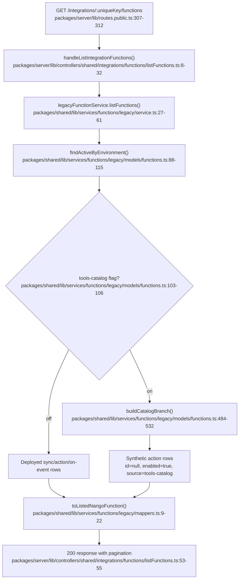
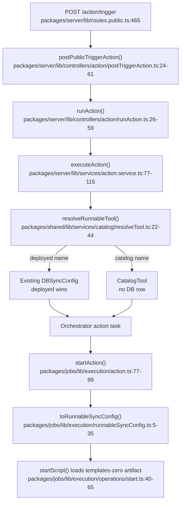

# Tools catalog

## What this is and why it exists

This feature changes the normal path for Nango-maintained **action functions**. Before it, a template was only runnable after a deployment created an active `_nango_sync_configs` row. The dashboard could then enable or disable that row. With the `tools-catalog` flag on, catalog actions can be listed and run without a customer-owned row or a deployment step. The live row is synthesized when functions are listed; execution resolves the action back to the catalog artifact.

The feature is account-scoped. `hasCatalogTools()` reads the `tools-catalog` feature flag and defaults to `false`, so the old behavior remains in place for accounts outside the rollout. When the flag is on, the implementation also treats every deployed action as enabled, even if its stored `enabled` value is false. Sync functions keep their stored enablement behavior.

The source of the live catalog is the shared `flows.zero.json` file. The catalog reader derives the action's metadata, input/output schema, SDK version, compiled JavaScript path, and TypeScript source path from that file. No database row is created for an unoccupied catalog action. This is what allows a catalog publication to change the code and metadata used by the next catalog execution instead of requiring a per-integration redeploy.

This checkout calls the feature `tools-catalog` internally, and the API uses `source: "tools-catalog"` for synthetic list rows. The dashboard presents the source as **Nango catalog**. For public documentation, the least confusing term is **Nango catalog actions** or **catalog action functions**. Keep **tool** for an action exposed to an agent or MCP client, and keep **action function** as the function type. Do not expose `auto-catalog` or the feature-flag name as the product name.

## Vocabulary

- **Function**: The product-level runtime primitive. This codebase has sync, action, and on-event function types.
- **Action function**: An on-demand function. It receives input and returns output, and is the only function type used as an agent tool.
- **Catalog action**: A Nango-maintained action from `flows.zero.json` that is served live when the flag is on and no deployed action owns the same name.
- **Catalog tool**: The internal `CatalogTool` shape. It contains catalog metadata and the object-storage paths needed to run or display the action's source.
- **Deployed function**: A function represented by an active database row. The row can be repo-managed, standalone, or a pinned catalog deployment.
- **Live catalog row**: A synthetic API/listing row with `id: null`, `last_deployed: null`, `enabled: true`, and `source: "tools-catalog"`. It is not a database `FunctionSource`.
- **Template**: The existing catalog blueprint and deployment surface. Sync templates still require deployment. Pulling a catalog action and deploying it is the customization/ownership path.
- **`tools-catalog`**: The internal feature-flag name and the API-only list source for live catalog rows.

## The moving parts

| File | Role |
|---|---|
| `packages/feature-flags/lib/flags.ts:76-83` | Reads the account-scoped feature flag and defines the rollout semantics. |
| `packages/shared/lib/services/catalog/actions.ts:13-35` | Defines the in-memory catalog action shape. |
| `packages/shared/lib/services/catalog/actions.ts:82-125` | Loads `flows.zero.json`, resolves schemas and aliases, and builds catalog paths. |
| `packages/shared/lib/services/catalog/resolveTool.ts:9-45` | Resolves a name to a deployed action first, then to a live catalog action. |
| `packages/shared/lib/services/functions/legacy/models/functions.ts:88-162` | Builds paginated function availability and applies the flag's enabled-state projection. |
| `packages/shared/lib/services/functions/legacy/models/functions.ts:426-532` | Unions deployed/on-event rows with unoccupied catalog actions. |
| `packages/shared/lib/services/functions/legacy/service.ts:23-65` | Exposes the merged list through the function service. |
| `packages/shared/lib/services/functions/legacy/mappers.ts:9-70` | Maps database and synthetic rows to the public function response. |
| `packages/types/lib/functions/domain.ts:41-65` | Distinguishes deployed availability from nullable live-list availability. |
| `packages/server/lib/controllers/shared/integrations/functions/listFunctions.ts:8-56` | Adapts the merged service result to the HTTP response. |
| `packages/server/lib/controllers/shared/integrations/functions/getCode.ts:49-124` | Returns deployed source or falls back to catalog TypeScript source. |
| `packages/server/lib/services/action.service.ts:42-150` | Resolves and triggers synchronous or asynchronous action execution. |
| `packages/jobs/lib/execution/action.ts:51-99` | Resolves the action again in the worker and turns a catalog action into a runnable config. |
| `packages/jobs/lib/execution/runnableSyncConfig.ts:5-35` | Adapts a catalog action to the runner's existing `DBSyncConfig` shape. |
| `packages/jobs/lib/execution/operations/start.ts:40-48` | Fetches `templates-zero` artifacts remotely and invokes the runtime. |
| `packages/webapp/src/pages/Integrations/providerConfigKey/Functions/Tab.tsx:273-396` | Combines the catalog-aware list with the legacy template endpoint. |
| `packages/webapp/src/pages/Integrations/components/FunctionSwitch.tsx:127-147` | Removes the status toggle for live catalog rows while retaining it for syncs and legacy rows. |
| `packages/server/lib/controllers/mcp/connectionToolsServer.ts:22-67` | Advertises enabled actions, including live catalog actions, as MCP connection tools. |
| `packages/server/lib/services/agentSessionToolset.service.ts:69-92` | Compiles agent-session tools from deployed functions plus catalog actions. |

## The flow

The main listing path is the important entry point because every dashboard/API/MCP consumer reuses it.

An action trigger follows the same resolver in the HTTP path and in the asynchronous worker. The worker resolves again because the actual script load happens after the task is queued.

## The code path, step by step

### 1. The flag gates the whole live behavior

`hasCatalogTools(accountUuid)` calls the feature-flag client with the internal key `tools-catalog` and a false default. Its comment states the two behaviors that matter: catalog actions are included, and disabled deployed actions are treated as enabled while the flag is on. The account UUID is the targeting key, so this is not a global process switch. `packages/feature-flags/lib/flags.ts:76-83`

The dashboard receives the same decision through `GET /api/v1/meta`. The response exposes it as `data.toolsCatalog`; the webapp uses that field to hide the legacy action status column until the flag is known to be off. `packages/server/lib/controllers/v1/meta/getMeta.ts:24-36` and `packages/types/lib/meta/api.ts:19-32`

### 2. The catalog reader turns `flows.zero.json` into runnable metadata

`CatalogTool` contains the fields needed by both listing and execution: name, description, input/output model names, scopes, JSON schema, version, SDK version, compiled JS path, TypeScript source path, capabilities, and the fixed module type `action`. `packages/shared/lib/services/catalog/actions.ts:13-32`

The reader loads `flows.zero.json` lazily. It finds the provider entry, uses `symLinkTargetName` when a provider is an alias, resolves a function-level schema or filters the integration-level schema to the action's used models, and creates the two paths under `templates-zero/`. The compiled path is used to run the action; the TypeScript path is used to show or pull its source. `packages/shared/lib/services/catalog/actions.ts:37-80`

The provider's actions are cached in `toolsByProvider` and `toolByProviderAndName`. Unknown providers are cached as empty lists. This makes lookup cheap, but it also means a running process keeps the catalog data it first loaded for that provider. `packages/shared/lib/services/catalog/actions.ts:82-125`

### 3. The list model merges catalog actions into deployed functions

`findActiveByEnvironment()` first resolves the integration's provider and account UUID, checks the flag, and creates the catalog action list only when the flag is on and the requested type is not `sync` or `on-event`. It then passes that list into one SQL listing subquery and applies the same pagination and ordering to the merged result. `packages/shared/lib/services/functions/legacy/models/functions.ts:44-56` and `packages/shared/lib/services/functions/legacy/models/functions.ts:88-115`

The catalog branch cross-joins the current integration with a JSON recordset built from the in-memory catalog. It excludes any name already occupied by an active deployed action. The returned row is deliberately synthetic: `id` and `last_deployed` are null, `enabled` is true, and `source` is the API-only string `tools-catalog`. The JSON schema is omitted from SQL and hydrated after pagination because it can be large. `packages/shared/lib/services/functions/legacy/models/functions.ts:453-532`

The deployed branch still includes active database rows, and the on-event branch is unchanged. Because the catalog branch uses `whereNotExists` against active action rows, a deployed action wins regardless of whether its source is `repo`, `standalone`, or the older pinned `catalog` source. A same-named deployed sync does not hide a catalog action because the collision check is restricted to `type = action`. `packages/shared/lib/services/functions/legacy/models/functions.ts:439-447` and `packages/shared/lib/services/functions/legacy/models/functions.ts:499-507`

After the SQL result is hydrated, `markActionsEnabled()` changes every non-true action row to `enabled: true` when the flag is on. This includes a disabled deployed action. It does not change sync or on-event rows. The stored database value is not changed. `packages/shared/lib/services/functions/legacy/models/functions.ts:58-60` and `packages/shared/lib/services/functions/legacy/models/functions.ts:112-115`

The service maps the rows into the public union and returns both list pages and totals. Its own contract explicitly says the result contains deployed functions plus catalog actions. `packages/shared/lib/services/functions/legacy/service.ts:23-65`

The public type makes the persistence boundary visible. A deployed availability object requires a numeric ID and deployment timestamp; a listed availability object permits null for both and permits the extra `tools-catalog` source. `packages/types/lib/functions/domain.ts:41-63`

### 4. HTTP, dashboard, and SDK consumers see the merged list

The private and public integration function routes both call the shared list controller. The controller passes the environment, provider config key, filters, page, and limit to `legacyFunctionService.listFunctions()`, then serializes the merged rows with pagination. `packages/server/lib/routes.private.ts:344-356`, `packages/server/lib/routes.public.ts:307-312`, and `packages/server/lib/controllers/shared/integrations/functions/listFunctions.ts:8-56`

The single-function endpoint uses the same model. If a deployed row and a catalog action share a name, the stable listing order returns the deployed row. `packages/server/lib/controllers/shared/integrations/functions/getFunction.ts:8-45` and `packages/shared/lib/services/functions/legacy/service.ts:104-130`

The webapp's Functions tab gets the flag from meta and the merged function pages from the functions endpoint. When a row has `source === 'tools-catalog'`, it renders **Enabled** with a tooltip saying catalog tools are always enabled. Otherwise it renders the old enabled/disabled label and switch. `packages/webapp/src/pages/Integrations/providerConfigKey/Functions/Tab.tsx:75-97`

The tab still calls the integration templates endpoint. For syncs and for accounts with the flag off, undeployed templates are appended after the deployed list. When the flag is on, catalog actions already occupy the list, so the tab avoids adding the same action template a second time and removes the action status column. The count comment records the same invariant: catalog actions are already included in the functions total. `packages/webapp/src/pages/Integrations/providerConfigKey/Functions/Tab.tsx:288-396`

The switch is explicitly disabled for live catalog rows. The same component remains active for syncs and for deployed rows when the flag is off, so the new behavior does not remove sync lifecycle controls. `packages/webapp/src/pages/Integrations/components/FunctionSwitch.tsx:37-71` and `packages/webapp/src/pages/Integrations/components/FunctionSwitch.tsx:127-147`

The source label calls the live source **Nango catalog** and explains that it is maintained by Nango and auto-updates. The other labels distinguish repo-managed code, standalone deployed code, pinned catalog deployments, and undeployed templates. `packages/webapp/src/pages/Integrations/providerConfigKey/Functions/FunctionSourceLabel.tsx:9-18`

### 5. Catalog source code is readable and can be pulled into ownership

The code endpoint first looks for a deployed sync-config or on-event source file. If no deployed match exists and the request is for an action or is type-ambiguous, it calls `resolveRunnableTool()`. A catalog result is read from its `sourceLocation` under `templates-zero` and returned as TypeScript. This is why a live catalog action can be inspected even though it has no row to download from. `packages/server/lib/controllers/shared/integrations/functions/getCode.ts:68-123`

The dashboard detail panel uses the environment pull command for any listed function, including a live catalog action. The environment endpoint returns the catalog source through the fallback above. Pulling that source and deploying it creates a customer-owned function, which then wins the name collision and stops following the live catalog. An undeployed template still uses the explicit `--catalog` pull command. `packages/webapp/src/pages/Integrations/providerConfigKey/Functions/FunctionDetailsPanel.tsx:77-86` and `packages/webapp/src/utils/scripts.ts:16-25`

The CLI's environment pull path calls the function code endpoint and writes the returned TypeScript into the local integration project. Its separate catalog pull path reads directly from the public catalog repository. That gives the two workflows different meanings: `--env` pulls what the environment currently serves, while `--catalog` explicitly selects the public template. `packages/cli/lib/services/pull.service.ts:50-120` and `packages/cli/lib/services/pull.service.ts:130-177`

### 6. Execution resolves deployed and live actions through one interface

The public action endpoint validates the provider config key, connection ID, action name, input, and async/retry headers before calling `runAction()`. `packages/server/lib/controllers/action/postTriggerAction.ts:12-61`

`executeAction()` verifies the connection and integration, then calls `resolveRunnableTool()`. The resolver checks the active deployed action first. If it finds a disabled row and the flag is on, it returns a copy with `enabled: true`; if the flag is off, it preserves the disabled value. If no row exists, the resolver only checks the catalog when the flag is on and returns a matching `CatalogTool`. Otherwise it returns `missing`. `packages/server/lib/services/action.service.ts:65-86` and `packages/shared/lib/services/catalog/resolveTool.ts:11-45`

The HTTP service records the deployed row ID when it has one, or the catalog name when the action is live, and then submits the action to the orchestrator. The catalog branch therefore does not need a special transport or API endpoint. `packages/server/lib/services/action.service.ts:86-115`

The asynchronous worker resolves the action again. For a catalog result it creates an in-memory `DBSyncConfig` with the catalog's name, version, metadata, input, schema, capabilities, SDK version, and compiled JS path. It sets `enabled: true` and uses the existing runner shape without inserting that config into the database. `packages/jobs/lib/execution/action.ts:77-99` and `packages/jobs/lib/execution/runnableSyncConfig.ts:5-35`

`startScript()` recognizes a `templates-zero/` file location and fetches the compiled module from remote storage before invoking the runtime. That is the last step that makes a catalog action directly runnable. `packages/jobs/lib/execution/operations/start.ts:40-65`

### 7. MCP and agent sessions consume the same catalog-aware inventory

The connection-tools MCP server calls `legacyFunctionService.listActions()`. It advertises only rows whose `enabled` field is true, converts the action schema to an MCP tool schema, and calls the shared `executeAction()` path. With the flag on, the list already contains catalog actions as enabled, so they are advertised and run without deployment. `packages/server/lib/controllers/mcp/connectionToolsServer.ts:40-67` and `packages/server/lib/controllers/mcp/connectionToolsServer.ts:96-140`

Agent-session compilation calls `findIntegrationFunctions()`, whose contract is explicitly “deployed rows plus catalog actions.” It groups the results by integration, filters them through the tenant's allow/deny policy, and divides allowed actions into pinned and searchable tools. A catalog action therefore participates in the same agent-session policy as a deployed action. `packages/server/lib/services/agentSessionToolset.service.ts:69-92` and `packages/shared/lib/services/functions/legacy/models/functions.ts:173-277`

## Conditions, branches, and edge cases

### Flag off versus flag on

With the flag off, the list contains only deployed sync-config and on-event rows, catalog fallback is disabled, and a disabled deployed action remains disabled. The old dashboard switch and deployment flow apply. The resolver tests explicitly cover both sides of this transition. `packages/shared/lib/services/catalog/resolveTool.unit.test.ts:79-128`

With the flag on, catalog actions are enabled by availability rather than by a user toggle. Existing disabled deployed actions also appear and execute as enabled, but their stored database value is left unchanged so turning the flag off restores the old disabled state. The integration tests cover the distinction between a disabled action and a disabled sync. `packages/shared/lib/services/functions/legacy/service.integration.test.ts:172-207`

### Deployed names take precedence

The implementation does not overlay a live catalog action on an occupied active action name. The deployed row is returned and the resolver uses its file location. This is the ownership boundary: deploying a same-named repo or standalone function replaces live catalog behavior for that integration/name. `packages/shared/lib/services/functions/legacy/models/functions.ts:499-507` and `packages/shared/lib/services/catalog/resolveTool.ts:27-33`

### Catalog actions are not deletable

The delete endpoint resolves the function through the merged list. It rejects a `tools-catalog` row with `400 invalid_request` because there is no customer row to delete. Repo functions remain undeletable through the endpoint for a different reason: they must be removed with `nango deploy`. `packages/server/lib/controllers/shared/integrations/functions/deleteFunction.ts:45-61`

### The catalog contains actions only

The catalog branch refuses `sync` and `on-event` requests, and `CatalogTool.module` is fixed to `action`. Sync templates still appear as undeployed templates in the dashboard and still require deployment/enablement. `packages/shared/lib/services/functions/legacy/models/functions.ts:51-56` and `packages/shared/lib/services/functions/legacy/models/functions.ts:439-447`

### The legacy `/scripts/config` endpoint is not the same inventory

`/scripts/config` calls `getSyncConfigsAsStandardConfig()`, which reads active database rows from `_nango_sync_configs`. It does not call the catalog-aware legacy function service. Therefore documentation that presents `/scripts/config` as the complete list of enabled action tools will omit live catalog actions. `packages/server/lib/controllers/scripts/config/getScriptsConfig.ts:24-40` and `packages/shared/lib/services/sync/config/config.service.ts:694-742`

### Catalog freshness has process and artifact boundaries

The catalog reader caches `flows.zero.json` and each provider's parsed actions in process memory. Catalog metadata becomes current when the running service has loaded the current catalog data. Execution reads the fixed `templates-zero` artifact path, so there is no per-customer deployment snapshot, but the service and object-storage publication still need to be updated by Nango's release process. `packages/shared/lib/services/catalog/actions.ts:10-11` and `packages/shared/lib/services/catalog/actions.ts:34-39`

### Tests encode the intended contract

The strongest behavioral tests are the catalog reader tests, resolver unit tests, merged-list integration tests, HTTP list tests, and MCP connection-tool tests. They verify nullable live IDs, source precedence, pagination, schema/list behavior, flag gating, and direct MCP execution. `packages/shared/lib/services/catalog/actions.unit.test.ts:5-38`, `packages/shared/lib/services/catalog/resolveTool.unit.test.ts:67-128`, `packages/server/lib/controllers/integrations/uniqueKey/functions/getFunctions.integration.test.ts:80-112`, and `packages/server/lib/controllers/mcp/connectionToolsServer.unit.test.ts:104-131`

## Documentation audit

The code and UI already expose the new model, but the docs still mostly describe the old “enable a template, then run a deployed function” model.

### High-priority changes

| Priority | Location | Problem | Required change |
|---|---|---|---|
| High | `docs/getting-started/quickstart.mdx:53-62` | Tells the reader to turn on the `get-repository` action toggle. | Say that the catalog action is already available after the integration/connection is ready. Keep the custom-function alternative. |
| High | `docs/guides/functions/functions-guide.mdx:13-20,32-67,258-267` | Treats all functions as deployed and calls Option 1 “enable a pre-built function.” | Split the normal paths: catalog actions are live and auto-updated; sync templates still require deployment; custom/repo functions require deployment. Reframe pull plus deploy as the ownership/customization path. |
| High | `docs/getting-started/use-cases/actions.mdx:23-43` | Says users must enable a template function. | Say users can use a catalog action directly or deploy a custom action. |
| High | `docs/getting-started/use-cases/tool-calling.mdx:13-42` | Says template action functions must be enabled and links `/scripts/config` as the programmatic list. | Explain that catalog actions are available automatically, and link to the catalog-aware functions list/API or agent-session docs. Do not promise `/scripts/config` includes live catalog actions. |
| High | `docs/reference/backend/http-api/functions/list.mdx:6-10`, `docs/reference/backend/http-api/functions/get.mdx:6-10`, `docs/reference/backend/http-api/functions/code.mdx:6-10`, `docs/reference/backend/http-api/functions/delete.mdx:6-10` | Describes only deployed functions and omits the non-deletable live catalog case. | Document that list/get/code can return catalog-backed actions; document `source: "tools-catalog"`, `id: null`, `last_deployed: null`, and delete's `invalid_request` response. |
| High | `docs/reference/backend/backend-sdk/node.mdx:868-1057` | Text and examples say “deployed” and show only non-null IDs and repo sources. | Add a catalog-action response example and state that get/list/code include live catalog actions; state that deletion does not remove them. |
| High | `docs/reference/backend/management-mcp.mdx:115-123` | `functions_list` is described as listing deployed functions. | Say it lists deployed functions plus live catalog actions; keep deployment tools described as the explicit ownership/customization path. |
| Medium | `docs/reference/backend/http-api/api-keys.mdx:143-208` | Scope descriptions say “list/read/delete deployed functions.” | Change descriptions to “list/read/delete functions” and mention that live catalog rows are readable but not deletable. |
| Medium | `docs/api-integrations/*.mdx` | Many provider pages say “Enable them in your dashboard” for a mixed sync/action table. | Replace the shared sentence with a split: enable sync functions; catalog actions are available without deployment; pull and deploy to customize. This is a repeated content change, not a reason to edit generated tables one by one. |
| Medium | `docs/llms-full.txt` | Generated output repeats the stale quickstart, enablement, and deployed-only API wording. | Update source MDX first, then run the documented LLM-doc generator. Do not hand-edit this generated file. |
| Low | `docs/updates/changelog.mdx:700-709` | Playground says it shows enabled functions but does not explain automatic catalog availability. | Add a release note when the feature becomes public; this is not a correctness blocker. |

### Content that is still mostly correct

- `docs/getting-started/use-cases/syncs.mdx:23-30` remains correct because sync templates still need explicit enablement/deployment.
- The code and deployment sections of `docs/guides/functions/action-functions.mdx:65-85` describe custom action code and are correct if the page says they are the custom/repo path. Add one short note rather than rewriting the page around catalog actions.
- `docs/guides/functions/ci-cd.mdx` remains correct for repo-managed functions. It should state that catalog actions do not belong in the customer deployment pipeline, while syncs and custom functions do.
- `docs/guides/agent-sessions.mdx` already describes a toolset of available action functions. It needs a short source/availability note, not a new execution model.

### Recommended public wording

Use this vocabulary consistently:

> **Catalog actions** are Nango-maintained action functions that are available as soon as the integration is available. They do not require a deployment and follow the latest catalog version. To change one, pull it into your functions project and deploy it; the deployed function then becomes the integration's owned implementation.

Use **Nango catalog** in the dashboard-facing source label and **catalog action** in guides and API explanations. Keep **action function** for the function type and **tool** for an action when it is exposed to an agent/MCP client. Avoid documenting `tools-catalog`, `auto-catalog`, or “live row” as public product terminology.

Because the rollout is still feature-flagged, public docs should describe this behavior when the rollout is intended to be user-visible. They should not make customers configure or reason about the internal flag unless there is a separate rollout/support document.

## Worth its own dive

- The exact catalog publication pipeline: how `flows.zero.json` and `templates-zero` artifacts are produced and released together, and what “latest” means during a rolling deployment.
- The legacy template endpoint and dashboard merge behavior, especially what external consumers should infer from `deployed` when a live catalog action has no database row.
- The `findActionInputSchemas()` and agent-session paths for named action schemas, including the occupied-name rule when a disabled deployed action and a catalog action have the same name.
- The remaining legacy enable/disable endpoints and the separate `function_configs` lifecycle API; this document traced the action/function path used by the feature, not every function lifecycle implementation.
- The migration of public documentation and generated provider pages once the product terminology is approved.

The main list and execution paths above are traced from the current checkout. Any step can be expanded into a line-by-line reference if needed.
